# ERP 第一輪：完整系統分析與資料模型設計提案

> **DESIGN PROPOSAL／待Owner整體審查**。本文件是分析成果，不是已核准規格、實作、資料庫或執行測試報告。以下「建議」預設值、狀態、數量政策與鎖定規則均屬設計提案；D01–D16集中列出待決策事項。不得將結構一致性檢查視為Owner已批准業務政策。

## 1. 系統目的與業務範圍

服務小型文具製造及批發企業：筆記本、便條本、資料夾等成品；紙張、封面、膠、線圈等原料。涵蓋原料採購→接受收貨→BOM及途程→製造工單→實際領料→終端完工回報→成品實際入庫→銷售出貨，以及退貨、退料、盤點、調整、多倉調撥、查詢和雙向批次追溯。

業務範圍固定為六模組、30項作業；作業不等於資料表。本提案推導45個實體表、494個持久欄位，以及29個明確列示的查詢欄位；沒有任意限制表數、行數或批次數。財務總帳、應收應付、稅務申報、成本結算、無限階BOM、有限產能排程與在途物流不是本輪已確認範圍，是否納入須另決策。

設計核心：
- 品項共用穩定識別，原料／成品分業務維護視圖。
- 訂單／工單只是承諾及計畫；只有不可變庫存分錄改變現存量。
- 完工回報與成品入庫分開，杜絕雙重增加庫存。
- MRP以所有參與工單及全部有效保留一起計算，確認時再次鎖定驗證。
- 批次不是自由文字：原料批、領料、製造批、完工、成品批、出貨及客戶均有可遍歷外鍵。

## 2. 完整30項作業覆蓋矩陣

所有表名對應第3節完整字典；共用actor、unit、currency為支援結構，不增加業務作業數。

| 編號 | 業務作業 | 主要持久資料結構 | 行為與查詢依據 |
| --- | --- | --- | --- |
| 01 | 產品分類維護 | item_category | item.category_id；層級無循環 |
| 02 | 原料主檔維護 | item, unit, item_unit_conversion | RAW維護視圖；基本單位／批次規則 |
| 03 | 成品主檔維護 | item, unit, item_unit_conversion | FINISHED維護視圖；共用品項識別 |
| 04 | 客戶維護 | customer, currency | 交易前有效性與原單快照 |
| 05 | 供應商維護 | supplier, currency | 停用不刪交易 |
| 06 | 倉庫維護 | warehouse, stock_position | 倉別可用性與並行鎖 |
| 07 | 工作中心維護 | work_center | 預定與實際中心 |
| 08 | 供應商原料報價 | supplier_offer, supplier, item, unit, currency | 供應商↔原料多對多；價格版本 |
| 09 | 採購單管理 | purchase_order, purchase_order_line, purchase_line_cancellation | 表頭／明細／未交餘量取消與行SUM |
| 10 | 採購收貨 | stock_document, stock_document_line, stock_posting, stock_entry, inventory_lot | PURCHASE_RECEIPT；只接受量入帳 |
| 11 | 退供應商 | stock_document, stock_document_line | SUPPLIER_RETURN；必追原收貨、是否重開待核 |
| 12 | 採購未交查詢 | purchase_order_line, purchase_line_cancellation, stock_document_line, stock_posting | 查詢推導，不另存未交表 |
| 13 | BOM | bom, bom_component | 成品↔原料多對多；單層版本 |
| 14 | 途程與作業 | routing, routing_step, operation_definition, work_center | 成品版本內有序步驟 |
| 15 | 製造工單 | work_order, work_order_material, work_order_step, production_batch | 發放時凍結標準與途程 |
| 16 | MRP Lite | mrp_run, mrp_demand, mrp_supply, mrp_allocation, stock_reservation, reservation_event | 多工單同輪分配、確認重驗，不重配供應 |
| 17 | 製造領料 | stock_document, stock_document_line, stock_posting, stock_entry, reservation_event | MATERIAL_ISSUE；實際扣帳與保留消耗同交易 |
| 18 | 製造退料 | stock_document, stock_document_line, reservation_event | MATERIAL_RETURN；原領料、批次、未用量核對 |
| 19 | 生產完工與進度 | operation_report, production_completion, production_batch, work_order_step | 逐站進度與終端良品授權分開；均不直接入庫 |
| 20 | 成品入庫 | stock_document, stock_document_line, inventory_lot, manufacturing_genealogy | FG_RECEIPT；引用完工授權，僅此增加成品庫存 |
| 21 | 銷售訂單 | sales_order, sales_order_line, sales_line_cancellation | 表頭明細、價格快照、SUM |
| 22 | 銷售出貨 | stock_document, stock_document_line, stock_posting, stock_entry | SALES_SHIPMENT；分批出貨實際扣帳 |
| 23 | 客戶退貨 | stock_document, stock_document_line, stock_status | CUSTOMER_RETURN／QUALITY_DISPOSITION；待驗、可用或報廢處置 |
| 24 | 銷售未交查詢 | sales_order_line, sales_line_cancellation, stock_document_line, stock_posting | 出貨履約及客退重開分開 |
| 25 | 庫存盤點 | stocktake, stocktake_line, stocktake_count | 帳面快照、實盤複盤與採用數 |
| 26 | 庫存調整 | stock_document, stock_document_line, stock_posting, stock_entry | ADJUSTMENT；盤差或核准原因，非直接改餘額 |
| 27 | 倉間調撥 | stock_document, stock_document_line, stock_posting, stock_entry | TRANSFER；兩倉同交易、同批、總量守恆 |
| 28 | 即時原料與成品庫存 | stock_entry, stock_position, inventory_lot, item, stock_reservation | 分錄SUM、保留／可用量查詢 |
| 29 | 異動與雙向批次追溯 | stock_entry, inventory_lot, production_batch, manufacturing_genealogy, stock_document_line | 原料批↔領料↔製造批／工單↔成品入庫批↔出貨↔客戶 |
| 30 | 採購／製造／銷售統計 | purchase_order_line, sales_order_line, stock_posting, stock_entry, production_completion, operation_report | 有效事件聚合、幣別分組；避免join乘積 |

## 3. 所有提案表與完整欄位字典

### 3.1 字典解讀、鍵值、型別與預設的共同規則

本章**所有**欄位均是提案，不是既有資料庫。每張表下列出全部實體欄位，沒有省略「其他欄位」或僅示範部分欄位；查詢欄另表明列，未存入主表。每個實體欄位列出中文名稱、技術名、型別、用途、鍵角色、來源分類、NULL與預設及限制。

- UUID為建議穩定內部PK；document_no、completion_no、run_no、code等為可讀業務識別。序號與UUID不能互換。每表id為PK且不可修改；其他一般欄位不是外鍵。
- UUID、TEXT、DECIMAL、BIGINT、INTEGER、BOOLEAN、DATE、TIMESTAMPTZ為邏輯型別，建議後續對應PostgreSQL。TEXT不加任意長度；DECIMAL暫不指定任意精度／小數位；INTEGER/BIGINT只是排序及版本整數型別，不另加任意業務上下限。D04決定實際精度、捨入、整件單位規則；不使用浮點數計金額或庫存。
- 不加籠統「所有數量／金額非負」或任意最大數值CHECK。庫存分錄、沖回事件及取消回復明確需要有號數；一般業務量的負數語義、超收／超領／超產等由D04–D06決定。分母必須有可定義換算意義；除零時不產生虛構數字，工作流需補正資料。
- 表中「可空」之外均為必要資料。NULL表示未知／不適用，不能用0冒充未盤、未估工時或未提供價格。系統時間預設交易建立時間；業務日期由使用者確認，不以主機今天代替已知實際日期。
- 每表created_at與created_by為內部資料稽核，不是對話檔的metadata。actor是稽核身分目錄，不儲存密碼。master的row_version初始1是並行修改機制，不是業務數量限制。
- 來源USER是輸入／確認，SYSTEM為產生或來源快照，CALCULATED為公式產生且不可自由修改，QUERY為查詢推導。外鍵通常由使用者選取，created_by／核准者／過帳者等由已驗證身分帶入。
- 所有FK引用目標id；刪除及PK更新一律RESTRICT，包含明細對表頭與自我關聯。沒有ON DELETE CASCADE。純草稿可在同一交易明確刪子再刪父；有核准、引用、過帳或回報的資料不得物理刪除，改停用、取消餘量或相反事件（D06）。不是把所有取消都當成庫存沖回。
- 每表列出的複合UNIQUE之外，PK均唯一；標示「唯一FK」也是UNIQUE。可空唯一欄建議只對非NULL值檢查唯一，不限制多筆NULL。所有FK設索引；常用額外索引見第4節。生效日／截止日須形成可解釋的時間區間，狀態欄位只允許該工作流已核准的代碼，不是任意自由字串。不自動假設稅號、電話或人名全域唯一。
- 跨欄位業務規則不能只靠存在性FK：下列一致性規則須用複合FK／約束觸發器／同交易服務驗證實現。最終採用方式是後續工程設計，不是假稱本輪已建constraint。

### 3.2 持久表與完整欄位字典

#### 01. 操作人員 — `actor`

目的：僅提供稽核引用；登入及權限實作留待後續。 關聯作業：01–30。

識別與唯一性：id為PK；UNIQUE(login_key)；UNIQUE(external_subject)。

| 中文欄名 | 技術欄名 | 型別 | 用途 | 角色／參照 | 來源 | 空值／預設與理由 |
| --- | --- | --- | --- | --- | --- | --- |
| 內部識別碼 | `id` | UUID | 穩定主鍵；不作業務單號 | PK | SYSTEM | 必填；系統產生UUID |
| 登入識別 | `login_key` | TEXT | 既有身分提供者之穩定名稱 | 普通欄 | USER | 必填；無 |
| 顯示名稱 | `display_name` | TEXT | 稽核可讀名稱 | 普通欄 | USER | 必填；無 |
| 外部身分 | `external_subject` | TEXT | 可選外部登入主體；不儲存密碼 | 普通欄 | USER | 可空；NULL |
| 啟用 | `is_active` | BOOLEAN | 控制後續選用；停用不刪歷史 | 普通欄 | USER | 必填；true（建議新建即啟用） |
| 修改時間 | `updated_at` | TIMESTAMPTZ | 樂觀鎖用最後修改時間 | 普通欄 | SYSTEM | 必填；交易時間（TIMESTAMPTZ，保留時區） |
| 資料版次 | `row_version` | BIGINT | 並行修改版本 | 普通欄 | SYSTEM | 必填；1；每次成功修改遞增 |
| 建立時間 | `created_at` | TIMESTAMPTZ | 建立稽核時間 | 普通欄 | SYSTEM | 必填；交易時間（TIMESTAMPTZ，保留時區） |

約束與修改保護：登入識別不可在有歷史後重用給另一人。停用人員仍可供舊交易引用；外部身分去連結須保留既有責任歸屬。

#### 02. 計量單位 — `unit`

目的：統一定義張、公斤、冊等單位。 關聯作業：02,03,08–27。

識別與唯一性：id為PK；UNIQUE(code)。

| 中文欄名 | 技術欄名 | 型別 | 用途 | 角色／參照 | 來源 | 空值／預設與理由 |
| --- | --- | --- | --- | --- | --- | --- |
| 內部識別碼 | `id` | UUID | 穩定主鍵；不作業務單號 | PK | SYSTEM | 必填；系統產生UUID |
| 單位代碼 | `code` | TEXT | 全域唯一代碼 | 普通欄 | USER | 必填；無 |
| 單位名稱 | `name` | TEXT | 顯示名稱 | 普通欄 | USER | 必填；無 |
| 數量取整規則 | `quantity_rule` | TEXT | D04建議允許小數；整件取整規則須核准 | 普通欄 | USER | 必填；DECIMAL |
| 啟用 | `is_active` | BOOLEAN | 控制後續選用；停用不刪歷史 | 普通欄 | USER | 必填；true（建議新建即啟用） |
| 修改時間 | `updated_at` | TIMESTAMPTZ | 樂觀鎖用最後修改時間 | 普通欄 | SYSTEM | 必填；交易時間（TIMESTAMPTZ，保留時區） |
| 資料版次 | `row_version` | BIGINT | 並行修改版本 | 普通欄 | SYSTEM | 必填；1；每次成功修改遞增 |
| 建立時間 | `created_at` | TIMESTAMPTZ | 建立稽核時間 | 普通欄 | SYSTEM | 必填；交易時間（TIMESTAMPTZ，保留時區） |
| 建立者 | `created_by` | UUID | 建立責任人 | FK→actor.id | SYSTEM（身分帶入） | 必填；無；必須引用既存資料 |

約束與修改保護：代碼／唯一鍵與引用按本章共同規則維護；停用不切斷歷史FK。欄位更新須驗證row_version；往來對象與地址的原單快照不因主檔更名而改寫。

#### 03. 幣別 — `currency`

目的：單據價格幣別；不提供總帳或匯兌會計。 關聯作業：08,09,21,30。

識別與唯一性：id為PK；UNIQUE(code)。

| 中文欄名 | 技術欄名 | 型別 | 用途 | 角色／參照 | 來源 | 空值／預設與理由 |
| --- | --- | --- | --- | --- | --- | --- |
| 內部識別碼 | `id` | UUID | 穩定主鍵；不作業務單號 | PK | SYSTEM | 必填；系統產生UUID |
| 幣別代碼 | `code` | TEXT | 通用幣別代碼 | 普通欄 | USER | 必填；無 |
| 幣別名稱 | `name` | TEXT | 顯示名稱 | 普通欄 | USER | 必填；無 |
| 金額小數位 | `rounding_scale` | INTEGER | D04幣別取位建議；不預設任意上下限 | 普通欄 | USER | 必填；Owner指定 |
| 金額捨入模式 | `rounding_mode` | TEXT | D04建議HALF_UP，待Owner確認 | 普通欄 | USER | 必填；HALF_UP |
| 啟用 | `is_active` | BOOLEAN | 控制後續選用；停用不刪歷史 | 普通欄 | USER | 必填；true（建議新建即啟用） |
| 修改時間 | `updated_at` | TIMESTAMPTZ | 樂觀鎖用最後修改時間 | 普通欄 | SYSTEM | 必填；交易時間（TIMESTAMPTZ，保留時區） |
| 資料版次 | `row_version` | BIGINT | 並行修改版本 | 普通欄 | SYSTEM | 必填；1；每次成功修改遞增 |
| 建立時間 | `created_at` | TIMESTAMPTZ | 建立稽核時間 | 普通欄 | SYSTEM | 必填；交易時間（TIMESTAMPTZ，保留時區） |
| 建立者 | `created_by` | UUID | 建立責任人 | FK→actor.id | SYSTEM（身分帶入） | 必填；無；必須引用既存資料 |

約束與修改保護：代碼／唯一鍵與引用按本章共同規則維護；停用不切斷歷史FK。欄位更新須驗證row_version；往來對象與地址的原單快照不因主檔更名而改寫。

#### 04. 品項分類 — `item_category`

目的：原料與成品共用分類，避免兩套分類識別。 關聯作業：01。

識別與唯一性：id為PK；UNIQUE(code)。

| 中文欄名 | 技術欄名 | 型別 | 用途 | 角色／參照 | 來源 | 空值／預設與理由 |
| --- | --- | --- | --- | --- | --- | --- |
| 內部識別碼 | `id` | UUID | 穩定主鍵；不作業務單號 | PK | SYSTEM | 必填；系統產生UUID |
| 分類代碼 | `code` | TEXT | 唯一分類代碼 | 普通欄 | USER | 必填；無 |
| 分類名稱 | `name` | TEXT | 分類說明 | 普通欄 | USER | 必填；無 |
| 上層分類 | `parent_id` | UUID | 可選階層；禁止循環 | FK→item_category.id | USER（選取引用） | 可空；NULL（尚無對應） |
| 啟用 | `is_active` | BOOLEAN | 控制後續選用；停用不刪歷史 | 普通欄 | USER | 必填；true（建議新建即啟用） |
| 修改時間 | `updated_at` | TIMESTAMPTZ | 樂觀鎖用最後修改時間 | 普通欄 | SYSTEM | 必填；交易時間（TIMESTAMPTZ，保留時區） |
| 資料版次 | `row_version` | BIGINT | 並行修改版本 | 普通欄 | SYSTEM | 必填；1；每次成功修改遞增 |
| 建立時間 | `created_at` | TIMESTAMPTZ | 建立稽核時間 | 普通欄 | SYSTEM | 必填；交易時間（TIMESTAMPTZ，保留時區） |
| 建立者 | `created_by` | UUID | 建立責任人 | FK→actor.id | SYSTEM（身分帶入） | 必填；無；必須引用既存資料 |

約束與修改保護：parent_id不得指向自己或形成祖先循環。已有品項引用的分類只能停用；變更分類不宣稱已保存歷史分類快照。

#### 05. 品項主檔 — `item`

目的：同表兩種業務維護視圖RAW/FINISHED；避免庫存、BOM重複識別。 關聯作業：02,03。

識別與唯一性：id為PK；UNIQUE(code)。

| 中文欄名 | 技術欄名 | 型別 | 用途 | 角色／參照 | 來源 | 空值／預設與理由 |
| --- | --- | --- | --- | --- | --- | --- |
| 內部識別碼 | `id` | UUID | 穩定主鍵；不作業務單號 | PK | SYSTEM | 必填；系統產生UUID |
| 品號 | `code` | TEXT | 唯一業務料號 | 普通欄 | USER | 必填；無 |
| 品名 | `name` | TEXT | 品項名稱 | 普通欄 | USER | 必填；無 |
| 規格 | `specification` | TEXT | 紙張尺寸、封面等 | 普通欄 | USER | 可空；NULL |
| 品項類型 | `item_kind` | TEXT | D01建議RAW或FINISHED；非自由變更 | 普通欄 | USER | 必填；無 |
| 分類 | `category_id` | UUID | 分類 | FK→item_category.id | USER（選取引用） | 必填；無；必須引用既存資料 |
| 基本單位 | `base_unit_id` | UUID | 所有庫存與BOM歸一單位 | FK→unit.id | USER（選取引用） | 必填；無；必須引用既存資料 |
| 批次管理 | `lot_tracking` | BOOLEAN | D08建議原料與成品均逐批；未批准前不宣稱強制規格 | 普通欄 | USER | 必填；true（追溯設計假設） |
| 啟用 | `is_active` | BOOLEAN | 控制後續選用；停用不刪歷史 | 普通欄 | USER | 必填；true（建議新建即啟用） |
| 修改時間 | `updated_at` | TIMESTAMPTZ | 樂觀鎖用最後修改時間 | 普通欄 | SYSTEM | 必填；交易時間（TIMESTAMPTZ，保留時區） |
| 資料版次 | `row_version` | BIGINT | 並行修改版本 | 普通欄 | SYSTEM | 必填；1；每次成功修改遞增 |
| 建立時間 | `created_at` | TIMESTAMPTZ | 建立稽核時間 | 普通欄 | SYSTEM | 必填；交易時間（TIMESTAMPTZ，保留時區） |
| 建立者 | `created_by` | UUID | 建立責任人 | FK→actor.id | SYSTEM（身分帶入） | 必填；無；必須引用既存資料 |

約束與修改保護：D01建議item_kind=RAW/FINISHED。被BOM／交易／工單引用後，品號、品項類型及基本單位變更須遷移評估，不得直接改寫既有數量意義；名稱修改不覆蓋交易快照。

#### 06. 品項單位換算 — `item_unit_conversion`

目的：各品項交易單位轉基本單位；交易保留快照。 關聯作業：02,03,08–27。

識別與唯一性：id為PK；UNIQUE(item_id, unit_id)。

| 中文欄名 | 技術欄名 | 型別 | 用途 | 角色／參照 | 來源 | 空值／預設與理由 |
| --- | --- | --- | --- | --- | --- | --- |
| 內部識別碼 | `id` | UUID | 穩定主鍵；不作業務單號 | PK | SYSTEM | 必填；系統產生UUID |
| 品項 | `item_id` | UUID | 換算所屬品項 | FK→item.id | USER（選取引用） | 必填；無；必須引用既存資料 |
| 交易單位 | `unit_id` | UUID | 採購／銷售／製造單位 | FK→unit.id | USER（選取引用） | 必填；無；必須引用既存資料 |
| 換算係數 | `base_units_per_unit` | DECIMAL | 1交易單位對應基本單位數 | 普通欄 | USER | 必填；無 |
| 啟用 | `is_active` | BOOLEAN | 控制後續選用；停用不刪歷史 | 普通欄 | USER | 必填；true（建議新建即啟用） |
| 修改時間 | `updated_at` | TIMESTAMPTZ | 樂觀鎖用最後修改時間 | 普通欄 | SYSTEM | 必填；交易時間（TIMESTAMPTZ，保留時區） |
| 資料版次 | `row_version` | BIGINT | 並行修改版本 | 普通欄 | SYSTEM | 必填；1；每次成功修改遞增 |
| 建立時間 | `created_at` | TIMESTAMPTZ | 建立稽核時間 | 普通欄 | SYSTEM | 必填；交易時間（TIMESTAMPTZ，保留時區） |
| 建立者 | `created_by` | UUID | 建立責任人 | FK→actor.id | SYSTEM（身分帶入） | 必填；無；必須引用既存資料 |

約束與修改保護：同品項同交易單位唯一；基本單位需有1:1有效換算。換算改動只影響新草稿快照，不回算既有單據。

#### 07. 客戶 — `customer`

目的：客戶主檔與訂單歷史名稱分離。 關聯作業：04,21–24,29,30。

識別與唯一性：id為PK；UNIQUE(code)。

| 中文欄名 | 技術欄名 | 型別 | 用途 | 角色／參照 | 來源 | 空值／預設與理由 |
| --- | --- | --- | --- | --- | --- | --- |
| 內部識別碼 | `id` | UUID | 穩定主鍵；不作業務單號 | PK | SYSTEM | 必填；系統產生UUID |
| 客戶代碼 | `code` | TEXT | 唯一業務代碼 | 普通欄 | USER | 必填；無 |
| 客戶名稱 | `name` | TEXT | 現行名稱 | 普通欄 | USER | 必填；無 |
| 稅籍號碼 | `tax_identifier` | TEXT | D02所在地格式待定 | 普通欄 | USER | 可空；NULL |
| 聯絡人 | `contact_name` | TEXT | 日常窗口 | 普通欄 | USER | 可空；NULL |
| 電話 | `phone` | TEXT | 原樣文字；非數字型 | 普通欄 | USER | 可空；NULL |
| 電子郵件 | `email` | TEXT | 非空時驗證格式 | 普通欄 | USER | 可空；NULL |
| 帳單地址 | `billing_address` | TEXT | 文字地址；不自動當出貨地址 | 普通欄 | USER | 可空；NULL |
| 預設送貨地址 | `default_ship_address` | TEXT | 單據建立時複製 | 普通欄 | USER | 可空；NULL |
| 付款條件 | `payment_terms` | TEXT | 文字條件；本輪不建立應收帳 | 普通欄 | USER | 可空；NULL |
| 預設幣別 | `currency_id` | UUID | 單據幣別初始建議 | FK→currency.id | USER（選取引用） | 必填；無；必須引用既存資料 |
| 啟用 | `is_active` | BOOLEAN | 控制後續選用；停用不刪歷史 | 普通欄 | USER | 必填；true（建議新建即啟用） |
| 修改時間 | `updated_at` | TIMESTAMPTZ | 樂觀鎖用最後修改時間 | 普通欄 | SYSTEM | 必填；交易時間（TIMESTAMPTZ，保留時區） |
| 資料版次 | `row_version` | BIGINT | 並行修改版本 | 普通欄 | SYSTEM | 必填；1；每次成功修改遞增 |
| 建立時間 | `created_at` | TIMESTAMPTZ | 建立稽核時間 | 普通欄 | SYSTEM | 必填；交易時間（TIMESTAMPTZ，保留時區） |
| 建立者 | `created_by` | UUID | 建立責任人 | FK→actor.id | SYSTEM（身分帶入） | 必填；無；必須引用既存資料 |

約束與修改保護：代碼／唯一鍵與引用按本章共同規則維護；停用不切斷歷史FK。欄位更新須驗證row_version；往來對象與地址的原單快照不因主檔更名而改寫。

#### 08. 供應商 — `supplier`

目的：供應商與報價、採購來源。 關聯作業：05,08–12,29,30。

識別與唯一性：id為PK；UNIQUE(code)。

| 中文欄名 | 技術欄名 | 型別 | 用途 | 角色／參照 | 來源 | 空值／預設與理由 |
| --- | --- | --- | --- | --- | --- | --- |
| 內部識別碼 | `id` | UUID | 穩定主鍵；不作業務單號 | PK | SYSTEM | 必填；系統產生UUID |
| 供應商代碼 | `code` | TEXT | 唯一業務代碼 | 普通欄 | USER | 必填；無 |
| 供應商名稱 | `name` | TEXT | 現行名稱 | 普通欄 | USER | 必填；無 |
| 稅籍號碼 | `tax_identifier` | TEXT | D02格式待定 | 普通欄 | USER | 可空；NULL |
| 聯絡人 | `contact_name` | TEXT | 窗口 | 普通欄 | USER | 可空；NULL |
| 電話 | `phone` | TEXT | 文字電話 | 普通欄 | USER | 可空；NULL |
| 電子郵件 | `email` | TEXT | 非空時驗證格式 | 普通欄 | USER | 可空；NULL |
| 地址 | `address` | TEXT | 聯絡及退貨地址 | 普通欄 | USER | 可空；NULL |
| 付款條件 | `payment_terms` | TEXT | 本輪不建立應付帳 | 普通欄 | USER | 可空；NULL |
| 預設幣別 | `currency_id` | UUID | 報價與採購幣別建議 | FK→currency.id | USER（選取引用） | 必填；無；必須引用既存資料 |
| 啟用 | `is_active` | BOOLEAN | 控制後續選用；停用不刪歷史 | 普通欄 | USER | 必填；true（建議新建即啟用） |
| 修改時間 | `updated_at` | TIMESTAMPTZ | 樂觀鎖用最後修改時間 | 普通欄 | SYSTEM | 必填；交易時間（TIMESTAMPTZ，保留時區） |
| 資料版次 | `row_version` | BIGINT | 並行修改版本 | 普通欄 | SYSTEM | 必填；1；每次成功修改遞增 |
| 建立時間 | `created_at` | TIMESTAMPTZ | 建立稽核時間 | 普通欄 | SYSTEM | 必填；交易時間（TIMESTAMPTZ，保留時區） |
| 建立者 | `created_by` | UUID | 建立責任人 | FK→actor.id | SYSTEM（身分帶入） | 必填；無；必須引用既存資料 |

約束與修改保護：代碼／唯一鍵與引用按本章共同規則維護；停用不切斷歷史FK。欄位更新須驗證row_version；往來對象與地址的原單快照不因主檔更名而改寫。

#### 09. 倉庫 — `warehouse`

目的：多倉管理；本輪不另建儲位階層。 關聯作業：06,10–12,16–18,20,22–29。

識別與唯一性：id為PK；UNIQUE(code)。

| 中文欄名 | 技術欄名 | 型別 | 用途 | 角色／參照 | 來源 | 空值／預設與理由 |
| --- | --- | --- | --- | --- | --- | --- |
| 內部識別碼 | `id` | UUID | 穩定主鍵；不作業務單號 | PK | SYSTEM | 必填；系統產生UUID |
| 倉庫代碼 | `code` | TEXT | 唯一倉庫代碼 | 普通欄 | USER | 必填；無 |
| 倉庫名稱 | `name` | TEXT | 顯示名稱 | 普通欄 | USER | 必填；無 |
| 地址 | `address` | TEXT | 實體位置 | 普通欄 | USER | 可空；NULL |
| 納入MRP | `mrp_included` | BOOLEAN | D07是否供應可用庫存 | 普通欄 | USER | 必填；true（再受品質狀態限制） |
| 啟用 | `is_active` | BOOLEAN | 控制後續選用；停用不刪歷史 | 普通欄 | USER | 必填；true（建議新建即啟用） |
| 修改時間 | `updated_at` | TIMESTAMPTZ | 樂觀鎖用最後修改時間 | 普通欄 | SYSTEM | 必填；交易時間（TIMESTAMPTZ，保留時區） |
| 資料版次 | `row_version` | BIGINT | 並行修改版本 | 普通欄 | SYSTEM | 必填；1；每次成功修改遞增 |
| 建立時間 | `created_at` | TIMESTAMPTZ | 建立稽核時間 | 普通欄 | SYSTEM | 必填；交易時間（TIMESTAMPTZ，保留時區） |
| 建立者 | `created_by` | UUID | 建立責任人 | FK→actor.id | SYSTEM（身分帶入） | 必填；無；必須引用既存資料 |

約束與修改保護：代碼／唯一鍵與引用按本章共同規則維護；停用不切斷歷史FK。欄位更新須驗證row_version；往來對象與地址的原單快照不因主檔更名而改寫。

#### 10. 工作中心 — `work_center`

目的：裁切、印刷、裝訂等作業場所。 關聯作業：07,14,15,19,30。

識別與唯一性：id為PK；UNIQUE(code)。

| 中文欄名 | 技術欄名 | 型別 | 用途 | 角色／參照 | 來源 | 空值／預設與理由 |
| --- | --- | --- | --- | --- | --- | --- |
| 內部識別碼 | `id` | UUID | 穩定主鍵；不作業務單號 | PK | SYSTEM | 必填；系統產生UUID |
| 中心代碼 | `code` | TEXT | 唯一代碼 | 普通欄 | USER | 必填；無 |
| 中心名稱 | `name` | TEXT | 名稱 | 普通欄 | USER | 必填；無 |
| 中心說明 | `description` | TEXT | 設備或班別補充；不含產能排程引擎 | 普通欄 | USER | 可空；NULL |
| 啟用 | `is_active` | BOOLEAN | 控制後續選用；停用不刪歷史 | 普通欄 | USER | 必填；true（建議新建即啟用） |
| 修改時間 | `updated_at` | TIMESTAMPTZ | 樂觀鎖用最後修改時間 | 普通欄 | SYSTEM | 必填；交易時間（TIMESTAMPTZ，保留時區） |
| 資料版次 | `row_version` | BIGINT | 並行修改版本 | 普通欄 | SYSTEM | 必填；1；每次成功修改遞增 |
| 建立時間 | `created_at` | TIMESTAMPTZ | 建立稽核時間 | 普通欄 | SYSTEM | 必填；交易時間（TIMESTAMPTZ，保留時區） |
| 建立者 | `created_by` | UUID | 建立責任人 | FK→actor.id | SYSTEM（身分帶入） | 必填；無；必須引用既存資料 |

約束與修改保護：代碼／唯一鍵與引用按本章共同規則維護；停用不切斷歷史FK。欄位更新須驗證row_version；往來對象與地址的原單快照不因主檔更名而改寫。

#### 11. 供應商原料報價 — `supplier_offer`

目的：供應商與原料多對多含報價版本；下單價格另存快照。 關聯作業：08,09,16。

識別與唯一性：id為PK；UNIQUE(supplier_id, item_id, unit_id, currency_id, valid_from)。

| 中文欄名 | 技術欄名 | 型別 | 用途 | 角色／參照 | 來源 | 空值／預設與理由 |
| --- | --- | --- | --- | --- | --- | --- |
| 內部識別碼 | `id` | UUID | 穩定主鍵；不作業務單號 | PK | SYSTEM | 必填；系統產生UUID |
| 供應商 | `supplier_id` | UUID | 報價者 | FK→supplier.id | USER（選取引用） | 必填；無；必須引用既存資料 |
| 原料 | `item_id` | UUID | 只選RAW（D01） | FK→item.id | USER（選取引用） | 必填；無；必須引用既存資料 |
| 報價單位 | `unit_id` | UUID | 須有品項換算 | FK→unit.id | USER（選取引用） | 必填；無；必須引用既存資料 |
| 幣別 | `currency_id` | UUID | 報價幣別 | FK→currency.id | USER（選取引用） | 必填；無；必須引用既存資料 |
| 供應商料號 | `supplier_item_code` | TEXT | 原供應商識別 | 普通欄 | USER | 可空；NULL |
| 生效日 | `valid_from` | DATE | 報價期間起 | 普通欄 | USER | 必填；無 |
| 截止日 | `valid_to` | DATE | NULL表示尚未終止 | 普通欄 | USER | 可空；無 |
| 報價單價 | `unit_price` | DECIMAL | 每報價單位價格 | 普通欄 | USER | 必填；無 |
| 前置天數 | `lead_time_days` | INTEGER | MRP採購建議日期參考；未知保持NULL | 普通欄 | USER | 可空；NULL |
| 啟用 | `is_active` | BOOLEAN | 控制後續選用；停用不刪歷史 | 普通欄 | USER | 必填；true（建議新建即啟用） |
| 修改時間 | `updated_at` | TIMESTAMPTZ | 樂觀鎖用最後修改時間 | 普通欄 | SYSTEM | 必填；交易時間（TIMESTAMPTZ，保留時區） |
| 資料版次 | `row_version` | BIGINT | 並行修改版本 | 普通欄 | SYSTEM | 必填；1；每次成功修改遞增 |
| 建立時間 | `created_at` | TIMESTAMPTZ | 建立稽核時間 | 普通欄 | SYSTEM | 必填；交易時間（TIMESTAMPTZ，保留時區） |
| 建立者 | `created_by` | UUID | 建立責任人 | FK→actor.id | SYSTEM（身分帶入） | 必填；無；必須引用既存資料 |

約束與修改保護：item必為原料；unit須有品項換算；currency須與引用報價的採購單幣別一致。D03建議相同供應商／品項／單位／幣別有效期間不重疊；階梯價格尚未建模，若需要須擴充後核准。

#### 12. 製程作業 — `operation_definition`

目的：可重用裁切、印刷等作業定義。 關聯作業：14,19。

識別與唯一性：id為PK；UNIQUE(code)。

| 中文欄名 | 技術欄名 | 型別 | 用途 | 角色／參照 | 來源 | 空值／預設與理由 |
| --- | --- | --- | --- | --- | --- | --- |
| 內部識別碼 | `id` | UUID | 穩定主鍵；不作業務單號 | PK | SYSTEM | 必填；系統產生UUID |
| 作業代碼 | `code` | TEXT | 唯一代碼 | 普通欄 | USER | 必填；無 |
| 作業名稱 | `name` | TEXT | 作業顯示名稱 | 普通欄 | USER | 必填；無 |
| 作業說明 | `instruction` | TEXT | 標準工法 | 普通欄 | USER | 可空；NULL |
| 啟用 | `is_active` | BOOLEAN | 控制後續選用；停用不刪歷史 | 普通欄 | USER | 必填；true（建議新建即啟用） |
| 修改時間 | `updated_at` | TIMESTAMPTZ | 樂觀鎖用最後修改時間 | 普通欄 | SYSTEM | 必填；交易時間（TIMESTAMPTZ，保留時區） |
| 資料版次 | `row_version` | BIGINT | 並行修改版本 | 普通欄 | SYSTEM | 必填；1；每次成功修改遞增 |
| 建立時間 | `created_at` | TIMESTAMPTZ | 建立稽核時間 | 普通欄 | SYSTEM | 必填；交易時間（TIMESTAMPTZ，保留時區） |
| 建立者 | `created_by` | UUID | 建立責任人 | FK→actor.id | SYSTEM（身分帶入） | 必填；無；必須引用既存資料 |

約束與修改保護：代碼／唯一鍵與引用按本章共同規則維護；停用不切斷歷史FK。欄位更新須驗證row_version；往來對象與地址的原單快照不因主檔更名而改寫。

#### 13. 物料清單版本 — `bom`

目的：單層成品→原料的可發行BOM。 關聯作業：13,15,16。

識別與唯一性：id為PK；UNIQUE(product_id, revision)。

| 中文欄名 | 技術欄名 | 型別 | 用途 | 角色／參照 | 來源 | 空值／預設與理由 |
| --- | --- | --- | --- | --- | --- | --- |
| 內部識別碼 | `id` | UUID | 穩定主鍵；不作業務單號 | PK | SYSTEM | 必填；系統產生UUID |
| 成品 | `product_id` | UUID | 只選FINISHED（D01） | FK→item.id | USER（選取引用） | 必填；無；必須引用既存資料 |
| 版本 | `revision` | TEXT | 同成品版本唯一 | 普通欄 | USER | 必填；無 |
| 產出基準量 | `output_basis_qty` | DECIMAL | 此BOM產出多少基本單位成品 | 普通欄 | USER | 必填；無 |
| 生效日 | `valid_from` | DATE | 有效期間起 | 普通欄 | USER | 必填；無 |
| 截止日 | `valid_to` | DATE | 無截止時NULL | 普通欄 | USER | 可空；無 |
| 發行狀態 | `release_state` | TEXT | DRAFT/RELEASED/RETIRED（D06） | 普通欄 | USER | 必填；DRAFT |
| 啟用 | `is_active` | BOOLEAN | 控制後續選用；停用不刪歷史 | 普通欄 | USER | 必填；true（建議新建即啟用） |
| 修改時間 | `updated_at` | TIMESTAMPTZ | 樂觀鎖用最後修改時間 | 普通欄 | SYSTEM | 必填；交易時間（TIMESTAMPTZ，保留時區） |
| 資料版次 | `row_version` | BIGINT | 並行修改版本 | 普通欄 | SYSTEM | 必填；1；每次成功修改遞增 |
| 建立時間 | `created_at` | TIMESTAMPTZ | 建立稽核時間 | 普通欄 | SYSTEM | 必填；交易時間（TIMESTAMPTZ，保留時區） |
| 建立者 | `created_by` | UUID | 建立責任人 | FK→actor.id | SYSTEM（身分帶入） | 必填；無；必須引用既存資料 |

約束與修改保護：product為成品。發行版本有完整且可運算基準，所選日期適用；D10建議同成品已發行有效期間不重疊。已發放工單引用的版本不可改內容，另建版本。

#### 14. BOM用料明細 — `bom_component`

目的：成品與原料橋接；重複用料用不同明細保留用途。 關聯作業：13,15,16。

識別與唯一性：id為PK；UNIQUE(bom_id, line_no)。

| 中文欄名 | 技術欄名 | 型別 | 用途 | 角色／參照 | 來源 | 空值／預設與理由 |
| --- | --- | --- | --- | --- | --- | --- |
| 內部識別碼 | `id` | UUID | 穩定主鍵；不作業務單號 | PK | SYSTEM | 必填；系統產生UUID |
| BOM | `bom_id` | UUID | 所屬版本 | FK→bom.id | USER（選取引用） | 必填；無；必須引用既存資料 |
| 明細序 | `line_no` | INTEGER | 單內穩定序號 | 普通欄 | SYSTEM | 必填；依單內序列產生 |
| 原料 | `material_id` | UUID | 只選RAW | FK→item.id | USER（選取引用） | 必填；無；必須引用既存資料 |
| 標準用量 | `usage_qty_base` | DECIMAL | 每BOM產出基準所需原料基本量 | 普通欄 | USER | 必填；無 |
| 耗損加給量 | `scrap_allowance_base` | DECIMAL | 每產出基準額外計畫用料；D10待核准 | 普通欄 | USER | 必填；0（不臆測耗損） |
| 用料用途 | `purpose_note` | TEXT | 封面／內頁等 | 普通欄 | USER | 可空；NULL |
| 建立時間 | `created_at` | TIMESTAMPTZ | 建立稽核時間 | 普通欄 | SYSTEM | 必填；交易時間（TIMESTAMPTZ，保留時區） |
| 建立者 | `created_by` | UUID | 建立責任人 | FK→actor.id | SYSTEM（身分帶入） | 必填；無；必須引用既存資料 |

約束與修改保護：單層只許RAW材料；同原料可有不同用途多行，需求按material彙總而不丟明細。不得引入成品遞迴；BOM父版本發行後內容凍結。

#### 15. 製程途程版本 — `routing`

目的：成品作業步驟版本。 關聯作業：14,15,19。

識別與唯一性：id為PK；UNIQUE(product_id, revision)。

| 中文欄名 | 技術欄名 | 型別 | 用途 | 角色／參照 | 來源 | 空值／預設與理由 |
| --- | --- | --- | --- | --- | --- | --- |
| 內部識別碼 | `id` | UUID | 穩定主鍵；不作業務單號 | PK | SYSTEM | 必填；系統產生UUID |
| 成品 | `product_id` | UUID | 只選FINISHED | FK→item.id | USER（選取引用） | 必填；無；必須引用既存資料 |
| 版本 | `revision` | TEXT | 成品內唯一 | 普通欄 | USER | 必填；無 |
| 生效日 | `valid_from` | DATE | 可用期間起 | 普通欄 | USER | 必填；無 |
| 截止日 | `valid_to` | DATE | 無截止時NULL | 普通欄 | USER | 可空；無 |
| 發行狀態 | `release_state` | TEXT | D06提案狀態 | 普通欄 | USER | 必填；DRAFT |
| 啟用 | `is_active` | BOOLEAN | 控制後續選用；停用不刪歷史 | 普通欄 | USER | 必填；true（建議新建即啟用） |
| 修改時間 | `updated_at` | TIMESTAMPTZ | 樂觀鎖用最後修改時間 | 普通欄 | SYSTEM | 必填；交易時間（TIMESTAMPTZ，保留時區） |
| 資料版次 | `row_version` | BIGINT | 並行修改版本 | 普通欄 | SYSTEM | 必填；1；每次成功修改遞增 |
| 建立時間 | `created_at` | TIMESTAMPTZ | 建立稽核時間 | 普通欄 | SYSTEM | 必填；交易時間（TIMESTAMPTZ，保留時區） |
| 建立者 | `created_by` | UUID | 建立責任人 | FK→actor.id | SYSTEM（身分帶入） | 必填；無；必須引用既存資料 |

約束與修改保護：product為成品；有效期間與BOM分別管控，工單兩者產品必須一致。已引用之已發行版本不可直接修改。

#### 16. 途程步驟 — `routing_step`

目的：途程內有序作業，不使用作業名稱當識別。 關聯作業：14,15,19。

識別與唯一性：id為PK；UNIQUE(routing_id, sequence_no)。

| 中文欄名 | 技術欄名 | 型別 | 用途 | 角色／參照 | 來源 | 空值／預設與理由 |
| --- | --- | --- | --- | --- | --- | --- |
| 內部識別碼 | `id` | UUID | 穩定主鍵；不作業務單號 | PK | SYSTEM | 必填；系統產生UUID |
| 途程 | `routing_id` | UUID | 父版本 | FK→routing.id | USER（選取引用） | 必填；無；必須引用既存資料 |
| 步序 | `sequence_no` | INTEGER | 途程內唯一順序 | 普通欄 | USER | 必填；由使用者依工法編排 |
| 作業 | `operation_id` | UUID | 可重用作業 | FK→operation_definition.id | USER（選取引用） | 必填；無；必須引用既存資料 |
| 工作中心 | `work_center_id` | UUID | 預定執行中心 | FK→work_center.id | USER（選取引用） | 必填；無；必須引用既存資料 |
| 整備時間 | `setup_minutes` | DECIMAL | 每批參考分鐘 | 普通欄 | USER | 可空；NULL（未估） |
| 單位工時 | `run_minutes_per_base` | DECIMAL | 每成品基本單位參考分鐘 | 普通欄 | USER | 可空；NULL（未估） |
| 建立時間 | `created_at` | TIMESTAMPTZ | 建立稽核時間 | 普通欄 | SYSTEM | 必填；交易時間（TIMESTAMPTZ，保留時區） |
| 建立者 | `created_by` | UUID | 建立責任人 | FK→actor.id | SYSTEM（身分帶入） | 必填；無；必須引用既存資料 |

約束與修改保護：sequence_no排序有明確意義；未提案平行分支工序，若Owner要求重工／分流須擴充D10。

#### 17. 採購單 — `purchase_order`

目的：供應商採購需求；核准不增加庫存。 關聯作業：09–12,30。

識別與唯一性：id為PK；UNIQUE(document_no)。

| 中文欄名 | 技術欄名 | 型別 | 用途 | 角色／參照 | 來源 | 空值／預設與理由 |
| --- | --- | --- | --- | --- | --- | --- |
| 內部識別碼 | `id` | UUID | 穩定主鍵；不作業務單號 | PK | SYSTEM | 必填；系統產生UUID |
| 業務單號 | `document_no` | TEXT | 供使用者查詢；與UUID不同；全表唯一 | 普通欄 | USER | 必填；系統編號；格式由D03決定 |
| 核准狀態 | `approval_state` | TEXT | D06建議 DRAFT/APPROVED/CANCELLED；履約進度另外推導 | 普通欄 | USER | 必填；DRAFT（避免未核准執行） |
| 核准時間 | `approved_at` | TIMESTAMPTZ | 核准事件時間 | 普通欄 | SYSTEM | 可空；NULL（未核准） |
| 核准者 | `approved_by` | UUID | 核准責任人 | FK→actor.id | SYSTEM（身分帶入） | 可空；NULL（尚無對應） |
| 備註 | `note` | TEXT | 業務備註 | 普通欄 | USER | 可空；NULL |
| 供應商 | `supplier_id` | UUID | 採購對象 | FK→supplier.id | USER（選取引用） | 必填；無；必須引用既存資料 |
| 供應商名稱快照 | `supplier_name_snapshot` | TEXT | 避免主檔更名改變原單 | 普通欄 | USER | 必填；由選取供應商複製 |
| 幣別 | `currency_id` | UUID | 整單同幣別 | FK→currency.id | USER（選取引用） | 必填；無；必須引用既存資料 |
| 採購日 | `order_date` | DATE | 業務日期 | 普通欄 | USER | 必填；無 |
| 交貨地址快照 | `delivery_address_snapshot` | TEXT | 原單地址 | 普通欄 | USER | 可空；NULL |
| 付款條件快照 | `payment_terms_snapshot` | TEXT | 原單付款條件 | 普通欄 | USER | 可空；NULL |
| 建立時間 | `created_at` | TIMESTAMPTZ | 建立稽核時間 | 普通欄 | SYSTEM | 必填；交易時間（TIMESTAMPTZ，保留時區） |
| 建立者 | `created_by` | UUID | 建立責任人 | FK→actor.id | SYSTEM（身分帶入） | 必填；無；必須引用既存資料 |

查詢欄位（不持久化，QUERY；沒有可輸入預設）：

| 中文欄名 | 技術欄名 | 型別 | 依賴與推導 |
| --- | --- | --- | --- |
| 採購總額 | `total_amount` | DECIMAL | SUM逐行捨入金額；只在同幣別相加 |

約束與修改保護：核准前可改供應商且必重驗所有行與報價；有收退貨後不允許改對象。履約狀態由明細推導，與approval_state不同。

#### 18. 採購明細 — `purchase_order_line`

目的：允許同原料不同交期多行；已收貨量是查詢值。 關聯作業：09–12,30。

識別與唯一性：id為PK；UNIQUE(purchase_order_id, line_no)。

| 中文欄名 | 技術欄名 | 型別 | 用途 | 角色／參照 | 來源 | 空值／預設與理由 |
| --- | --- | --- | --- | --- | --- | --- |
| 內部識別碼 | `id` | UUID | 穩定主鍵；不作業務單號 | PK | SYSTEM | 必填；系統產生UUID |
| 採購單 | `purchase_order_id` | UUID | 父單 | FK→purchase_order.id | USER（選取引用） | 必填；無；必須引用既存資料 |
| 明細序 | `line_no` | INTEGER | 父單內唯一 | 普通欄 | SYSTEM | 必填；單內序列 |
| 原料 | `item_id` | UUID | D01僅RAW | FK→item.id | USER（選取引用） | 必填；無；必須引用既存資料 |
| 品名規格快照 | `description_snapshot` | TEXT | 原單品名規格 | 普通欄 | USER | 必填；從品項複製 |
| 下單單位 | `unit_id` | UUID | 交易單位 | FK→unit.id | USER（選取引用） | 必填；無；必須引用既存資料 |
| 換算快照 | `base_factor_snapshot` | DECIMAL | 每下單單位的基本量 | 普通欄 | SYSTEM | 必填；取有效品項換算 |
| 訂購量 | `ordered_qty` | DECIMAL | 下單交易量 | 普通欄 | USER | 必填；無 |
| 單價 | `unit_price` | DECIMAL | 每交易單位未稅單價 | 普通欄 | USER | 必填；無 |
| 預計到貨日 | `due_date` | DATE | 此行交期 | 普通欄 | USER | 必填；無 |
| 預計收貨倉 | `preferred_warehouse_id` | UUID | 建議值，實收以庫存明細為準 | FK→warehouse.id | USER（選取引用） | 必填；無；必須引用既存資料 |
| 報價依據 | `supplier_offer_id` | UUID | 可選報價來源；不得事後漂移 | FK→supplier_offer.id | USER（選取引用） | 可空；NULL（尚無對應） |
| 建立時間 | `created_at` | TIMESTAMPTZ | 建立稽核時間 | 普通欄 | SYSTEM | 必填；交易時間（TIMESTAMPTZ，保留時區） |
| 建立者 | `created_by` | UUID | 建立責任人 | FK→actor.id | SYSTEM（身分帶入） | 必填；無；必須引用既存資料 |

查詢欄位（不持久化，QUERY；沒有可輸入預設）：

| 中文欄名 | 技術欄名 | 型別 | 依賴與推導 |
| --- | --- | --- | --- |
| 訂購基本量 | `ordered_qty_base` | DECIMAL | ordered_qty×base_factor_snapshot |
| 未稅行金額 | `line_amount` | DECIMAL | round_currency(ordered_qty×unit_price) |
| 已驗收基本量 | `received_qty_base` | DECIMAL | 有效PURCHASE_RECEIPT接受量，不含拒收；含沖回效果 |
| 退供應商量 | `supplier_return_qty_base` | DECIMAL | 有效SUPPLIER_RETURN實物流量 |
| 未交量 | `outstanding_qty_base` | DECIMAL | 訂購基本量−取消量−已驗收量＋經批准重開量 |

約束與修改保護：supplier_offer若填，供應商、原料、單位、幣別必須與父單／明細相同；明細item=RAW。價格／數量快照核准後不靜默覆寫；未履約餘量取消用事件。已引用行的item、unit、factor與父單不得改掛。

#### 19. 採購餘量取消事件 — `purchase_line_cancellation`

目的：不改歷史訂量，以事件取消未履約餘量；更正採反向事件。 關聯作業：09,12。

識別與唯一性：id為PK；UNIQUE(request_key)；UNIQUE(reverses_id)。此表為不可變業務事件，後續更正不覆寫原事件。

| 中文欄名 | 技術欄名 | 型別 | 用途 | 角色／參照 | 來源 | 空值／預設與理由 |
| --- | --- | --- | --- | --- | --- | --- |
| 內部識別碼 | `id` | UUID | 穩定主鍵；不作業務單號 | PK | SYSTEM | 必填；系統產生UUID |
| 業務請求冪等鍵 | `request_key` | TEXT | 同請求重試只建立一次；相同鍵不同業務內容拒絕 | 普通欄 | SYSTEM | 必填；呼叫方提供並沿用；不可每次重試重新產生 |
| 採購明細 | `purchase_order_line_id` | UUID | 取消對象 | FK→purchase_order_line.id | USER（選取引用） | 必填；無；必須引用既存資料 |
| 取消量變化 | `cancel_qty_base_delta` | DECIMAL | 基本量有號增減；負值只用於有依據的取消回復 | 普通欄 | USER | 必填；無 |
| 原因 | `reason` | TEXT | 取消或回復原因 | 普通欄 | USER | 必填；無 |
| 回復原事件 | `reverses_id` | UUID | 回復對象；每事件至多一次 | FK→purchase_line_cancellation.id；UNIQUE | USER（選取引用） | 可空；NULL（尚無對應） |
| 生效時間 | `effective_at` | TIMESTAMPTZ | 業務取消時間 | 普通欄 | USER | 必填；使用者確認時間 |
| 建立時間 | `created_at` | TIMESTAMPTZ | 建立稽核時間 | 普通欄 | SYSTEM | 必填；交易時間（TIMESTAMPTZ，保留時區） |
| 建立者 | `created_by` | UUID | 建立責任人 | FK→actor.id | SYSTEM（身分帶入） | 必填；無；必須引用既存資料 |

約束與修改保護：取消事件只能針對尚可取消的餘量；回復必須完整反向且reverses_id指同一採購行；禁止回復鏈循環。是否允許核准後回復由D06決定。

#### 20. 銷售單 — `sales_order`

目的：客戶需求；訂單核准不扣庫存。 關聯作業：21–24,30。

識別與唯一性：id為PK；UNIQUE(document_no)。

| 中文欄名 | 技術欄名 | 型別 | 用途 | 角色／參照 | 來源 | 空值／預設與理由 |
| --- | --- | --- | --- | --- | --- | --- |
| 內部識別碼 | `id` | UUID | 穩定主鍵；不作業務單號 | PK | SYSTEM | 必填；系統產生UUID |
| 業務單號 | `document_no` | TEXT | 供使用者查詢；與UUID不同；全表唯一 | 普通欄 | USER | 必填；系統編號；格式由D03決定 |
| 核准狀態 | `approval_state` | TEXT | D06建議 DRAFT/APPROVED/CANCELLED；履約進度另外推導 | 普通欄 | USER | 必填；DRAFT（避免未核准執行） |
| 核准時間 | `approved_at` | TIMESTAMPTZ | 核准事件時間 | 普通欄 | SYSTEM | 可空；NULL（未核准） |
| 核准者 | `approved_by` | UUID | 核准責任人 | FK→actor.id | SYSTEM（身分帶入） | 可空；NULL（尚無對應） |
| 備註 | `note` | TEXT | 業務備註 | 普通欄 | USER | 可空；NULL |
| 客戶 | `customer_id` | UUID | 銷售對象 | FK→customer.id | USER（選取引用） | 必填；無；必須引用既存資料 |
| 客戶名稱快照 | `customer_name_snapshot` | TEXT | 原單名稱 | 普通欄 | USER | 必填；取選取客戶 |
| 幣別 | `currency_id` | UUID | 整單幣別 | FK→currency.id | USER（選取引用） | 必填；無；必須引用既存資料 |
| 訂單日 | `order_date` | DATE | 業務日期 | 普通欄 | USER | 必填；無 |
| 送貨地址快照 | `ship_address_snapshot` | TEXT | 此次實際約定地址 | 普通欄 | USER | 必填；無 |
| 付款條件快照 | `payment_terms_snapshot` | TEXT | 本輪不產生應收帳 | 普通欄 | USER | 可空；NULL |
| 建立時間 | `created_at` | TIMESTAMPTZ | 建立稽核時間 | 普通欄 | SYSTEM | 必填；交易時間（TIMESTAMPTZ，保留時區） |
| 建立者 | `created_by` | UUID | 建立責任人 | FK→actor.id | SYSTEM（身分帶入） | 必填；無；必須引用既存資料 |

查詢欄位（不持久化，QUERY；沒有可輸入預設）：

| 中文欄名 | 技術欄名 | 型別 | 依賴與推導 |
| --- | --- | --- | --- |
| 銷售總額 | `total_amount` | DECIMAL | SUM逐行捨入金額；不跨幣合計 |

約束與修改保護：有出退貨後客戶、幣別與送貨快照不得靜默重掛；地址更正需留業務依據，已出貨內容不回改。

#### 21. 銷售明細 — `sales_order_line`

目的：成品、價格與交貨需求。 關聯作業：21–24,30。

識別與唯一性：id為PK；UNIQUE(sales_order_id, line_no)。

| 中文欄名 | 技術欄名 | 型別 | 用途 | 角色／參照 | 來源 | 空值／預設與理由 |
| --- | --- | --- | --- | --- | --- | --- |
| 內部識別碼 | `id` | UUID | 穩定主鍵；不作業務單號 | PK | SYSTEM | 必填；系統產生UUID |
| 銷售單 | `sales_order_id` | UUID | 父單 | FK→sales_order.id | USER（選取引用） | 必填；無；必須引用既存資料 |
| 明細序 | `line_no` | INTEGER | 單內唯一 | 普通欄 | SYSTEM | 必填；單內序列 |
| 成品 | `item_id` | UUID | D01僅FINISHED | FK→item.id | USER（選取引用） | 必填；無；必須引用既存資料 |
| 品名規格快照 | `description_snapshot` | TEXT | 原單內容 | 普通欄 | USER | 必填；從成品複製 |
| 交易單位 | `unit_id` | UUID | 銷售單位 | FK→unit.id | USER（選取引用） | 必填；無；必須引用既存資料 |
| 換算快照 | `base_factor_snapshot` | DECIMAL | 每交易單位的基本量 | 普通欄 | SYSTEM | 必填；取有效換算 |
| 訂購量 | `ordered_qty` | DECIMAL | 交易量 | 普通欄 | USER | 必填；無 |
| 單價 | `unit_price` | DECIMAL | 未稅單價 | 普通欄 | USER | 必填；無 |
| 預計出貨日 | `due_date` | DATE | 行交期 | 普通欄 | USER | 必填；無 |
| 建議出貨倉 | `preferred_warehouse_id` | UUID | 實際出貨倉仍記於庫存明細 | FK→warehouse.id | USER（選取引用） | 必填；無；必須引用既存資料 |
| 建立時間 | `created_at` | TIMESTAMPTZ | 建立稽核時間 | 普通欄 | SYSTEM | 必填；交易時間（TIMESTAMPTZ，保留時區） |
| 建立者 | `created_by` | UUID | 建立責任人 | FK→actor.id | SYSTEM（身分帶入） | 必填；無；必須引用既存資料 |

查詢欄位（不持久化，QUERY；沒有可輸入預設）：

| 中文欄名 | 技術欄名 | 型別 | 依賴與推導 |
| --- | --- | --- | --- |
| 訂購基本量 | `ordered_qty_base` | DECIMAL | ordered_qty×base_factor_snapshot |
| 未稅行金額 | `line_amount` | DECIMAL | round_currency(ordered_qty×unit_price) |
| 已出貨量 | `shipped_qty_base` | DECIMAL | 有效SALES_SHIPMENT數量含沖回效果 |
| 客退量 | `customer_return_qty_base` | DECIMAL | 有效CUSTOMER_RETURN數量 |
| 未出貨量 | `outstanding_qty_base` | DECIMAL | 訂購基本量−取消量−已出貨量＋經批准重開量 |

約束與修改保護：D01預設只銷售FINISHED。核准後數量更動以取消剩餘需求及新訂單行處理；已引用的item／unit／factor／父單不可改掛。

#### 22. 銷售餘量取消事件 — `sales_line_cancellation`

目的：取消未出貨需求而非刪單。 關聯作業：21,24。

識別與唯一性：id為PK；UNIQUE(request_key)；UNIQUE(reverses_id)。此表為不可變業務事件，後續更正不覆寫原事件。

| 中文欄名 | 技術欄名 | 型別 | 用途 | 角色／參照 | 來源 | 空值／預設與理由 |
| --- | --- | --- | --- | --- | --- | --- |
| 內部識別碼 | `id` | UUID | 穩定主鍵；不作業務單號 | PK | SYSTEM | 必填；系統產生UUID |
| 業務請求冪等鍵 | `request_key` | TEXT | 同請求重試只建立一次；相同鍵不同業務內容拒絕 | 普通欄 | SYSTEM | 必填；呼叫方提供並沿用；不可每次重試重新產生 |
| 銷售明細 | `sales_order_line_id` | UUID | 取消對象 | FK→sales_order_line.id | USER（選取引用） | 必填；無；必須引用既存資料 |
| 取消量變化 | `cancel_qty_base_delta` | DECIMAL | 基本量有號事件 | 普通欄 | USER | 必填；無 |
| 原因 | `reason` | TEXT | 取消或回復原因 | 普通欄 | USER | 必填；無 |
| 回復原事件 | `reverses_id` | UUID | 一次完整回復 | FK→sales_line_cancellation.id；UNIQUE | USER（選取引用） | 可空；NULL（尚無對應） |
| 生效時間 | `effective_at` | TIMESTAMPTZ | 取消業務時間 | 普通欄 | USER | 必填；使用者確認時間 |
| 建立時間 | `created_at` | TIMESTAMPTZ | 建立稽核時間 | 普通欄 | SYSTEM | 必填；交易時間（TIMESTAMPTZ，保留時區） |
| 建立者 | `created_by` | UUID | 建立責任人 | FK→actor.id | SYSTEM（身分帶入） | 必填；無；必須引用既存資料 |

約束與修改保護：回復原事件須同一銷售明細且完整相反；不得把已出貨事實當作取消事件刪除。

#### 23. 製造工單 — `work_order`

目的：凍結BOM與途程快照；計畫與實際分開。 關聯作業：15–20,29,30。

識別與唯一性：id為PK；UNIQUE(document_no)。

| 中文欄名 | 技術欄名 | 型別 | 用途 | 角色／參照 | 來源 | 空值／預設與理由 |
| --- | --- | --- | --- | --- | --- | --- |
| 內部識別碼 | `id` | UUID | 穩定主鍵；不作業務單號 | PK | SYSTEM | 必填；系統產生UUID |
| 業務單號 | `document_no` | TEXT | 供使用者查詢；與UUID不同；全表唯一 | 普通欄 | USER | 必填；系統編號；格式由D03決定 |
| 核准狀態 | `approval_state` | TEXT | D06建議 DRAFT/APPROVED/CANCELLED；履約進度另外推導 | 普通欄 | USER | 必填；DRAFT（避免未核准執行） |
| 成品說明快照 | `product_description_snapshot` | TEXT | 發放時成品品名規格；不受之後更名影響 | 普通欄 | SYSTEM | 必填；取發放時成品主檔 |
| 核准時間 | `approved_at` | TIMESTAMPTZ | 核准事件時間 | 普通欄 | SYSTEM | 可空；NULL（未核准） |
| 核准者 | `approved_by` | UUID | 核准責任人 | FK→actor.id | SYSTEM（身分帶入） | 可空；NULL（尚無對應） |
| 備註 | `note` | TEXT | 業務備註 | 普通欄 | USER | 可空；NULL |
| 成品 | `product_id` | UUID | 製造目標 | FK→item.id | USER（選取引用） | 必填；無；必須引用既存資料 |
| BOM版本 | `bom_id` | UUID | 發放時來源版本 | FK→bom.id | USER（選取引用） | 必填；無；必須引用既存資料 |
| 途程版本 | `routing_id` | UUID | 發放時來源版本 | FK→routing.id | USER（選取引用） | 必填；無；必須引用既存資料 |
| 計畫量 | `planned_qty_base` | DECIMAL | 成品基本量 | 普通欄 | USER | 必填；無 |
| 預計開工日 | `planned_start` | DATE | 排程參考 | 普通欄 | USER | 必填；無 |
| 預計完工日 | `planned_finish` | DATE | MRP排序參考 | 普通欄 | USER | 必填；無 |
| 執行狀態 | `execution_state` | TEXT | D06建議PLANNED/RELEASED/ON_HOLD/CLOSED/CANCELLED；量進度另推導 | 普通欄 | USER | 必填；PLANNED |
| 需求銷售明細 | `sales_order_line_id` | UUID | 可選接單生產來源 | FK→sales_order_line.id | USER（選取引用） | 可空；NULL（尚無對應） |
| 發放時間 | `released_at` | TIMESTAMPTZ | 快照與保留生效時間 | 普通欄 | SYSTEM | 可空；NULL |
| 建立時間 | `created_at` | TIMESTAMPTZ | 建立稽核時間 | 普通欄 | SYSTEM | 必填；交易時間（TIMESTAMPTZ，保留時區） |
| 建立者 | `created_by` | UUID | 建立責任人 | FK→actor.id | SYSTEM（身分帶入） | 必填；無；必須引用既存資料 |

查詢欄位（不持久化，QUERY；沒有可輸入預設）：

| 中文欄名 | 技術欄名 | 型別 | 依賴與推導 |
| --- | --- | --- | --- |
| 淨良品完工量 | `net_good_completed_base` | DECIMAL | 終端完工良品量含其沖回；不加逐站作業量 |
| 淨終端不良量 | `net_defective_completed_base` | DECIMAL | 終端不良量含沖回；不重加站內缺陷 |
| 成品已入庫量 | `fg_received_base` | DECIMAL | 有效FG_RECEIPT基本量含沖回 |
| 待入庫良品量 | `remaining_to_receive_base` | DECIMAL | 淨終端良品−有效FG_RECEIPT |
| 良品進度比 | `progress_ratio` | DECIMAL | 淨良品完工／計畫量；分母為0時NULL，不截斷超產 |

約束與修改保護：product必與bom、routing產品一致，發放時僅用適用且已發行版本；material／step快照同交易形成。發放後計畫量／來源版本不自由更改；D06建議取消未執行餘量或拆新工單而非重算歷史。

#### 24. 工單用料快照 — `work_order_material`

目的：每工單標準需求；不隨BOM後續修改。 關聯作業：15–18,29。

識別與唯一性：id為PK；UNIQUE(work_order_id, line_no)。

| 中文欄名 | 技術欄名 | 型別 | 用途 | 角色／參照 | 來源 | 空值／預設與理由 |
| --- | --- | --- | --- | --- | --- | --- |
| 內部識別碼 | `id` | UUID | 穩定主鍵；不作業務單號 | PK | SYSTEM | 必填；系統產生UUID |
| 工單 | `work_order_id` | UUID | 父工單 | FK→work_order.id | USER（選取引用） | 必填；無；必須引用既存資料 |
| 原BOM明細 | `bom_component_id` | UUID | 來源追溯 | FK→bom_component.id | USER（選取引用） | 必填；無；必須引用既存資料 |
| 明細序 | `line_no` | INTEGER | 工單內唯一 | 普通欄 | SYSTEM | 必填；複製BOM序號 |
| 原料 | `material_id` | UUID | 快照原料 | FK→item.id | USER（選取引用） | 必填；無；必須引用既存資料 |
| 用量快照 | `usage_snapshot_base` | DECIMAL | 每BOM基準原料用量 | 普通欄 | SYSTEM | 必填；複製原BOM |
| 耗損快照 | `scrap_snapshot_base` | DECIMAL | 每基準加給量 | 普通欄 | SYSTEM | 必填；複製原BOM |
| 產出基準快照 | `output_basis_snapshot` | DECIMAL | 原BOM基準量 | 普通欄 | SYSTEM | 必填；複製BOM |
| 工單標準需求 | `required_qty_base` | DECIMAL | 發放時計算並鎖定；不是自由輸入 | 普通欄 | CALCULATED | 必填；見第6節需求公式 |
| 建立時間 | `created_at` | TIMESTAMPTZ | 建立稽核時間 | 普通欄 | SYSTEM | 必填；交易時間（TIMESTAMPTZ，保留時區） |
| 建立者 | `created_by` | UUID | 建立責任人 | FK→actor.id | SYSTEM（身分帶入） | 必填；無；必須引用既存資料 |

查詢欄位（不持久化，QUERY；沒有可輸入預設）：

| 中文欄名 | 技術欄名 | 型別 | 依賴與推導 |
| --- | --- | --- | --- |
| 淨領料量 | `net_issued_base` | DECIMAL | 有效領料−有效退料，含各自沖回 |
| 未領需求 | `remaining_need_base` | DECIMAL | max(required_qty_base−net_issued_base,0)；揭露超領量另列 |

約束與修改保護：material、原BOM明細及所屬BOM必與父工單一致；required_qty_base只按發放時計畫計算。保存零散同料多行，但MRP不得重複生成同一需求。

#### 25. 工單作業快照 — `work_order_step`

目的：保留預定途程，不因主檔改動改變原工單。 關聯作業：15,19。

識別與唯一性：id為PK；UNIQUE(work_order_id, sequence_no)。

| 中文欄名 | 技術欄名 | 型別 | 用途 | 角色／參照 | 來源 | 空值／預設與理由 |
| --- | --- | --- | --- | --- | --- | --- |
| 內部識別碼 | `id` | UUID | 穩定主鍵；不作業務單號 | PK | SYSTEM | 必填；系統產生UUID |
| 工單 | `work_order_id` | UUID | 父工單 | FK→work_order.id | USER（選取引用） | 必填；無；必須引用既存資料 |
| 來源步驟 | `routing_step_id` | UUID | 來源版本 | FK→routing_step.id | USER（選取引用） | 必填；無；必須引用既存資料 |
| 步序 | `sequence_no` | INTEGER | 工單內唯一 | 普通欄 | SYSTEM | 必填；複製途程 |
| 作業 | `operation_id` | UUID | 作業快照引用 | FK→operation_definition.id | USER（選取引用） | 必填；無；必須引用既存資料 |
| 工作中心 | `work_center_id` | UUID | 預定中心 | FK→work_center.id | USER（選取引用） | 必填；無；必須引用既存資料 |
| 整備時間快照 | `setup_minutes_snapshot` | DECIMAL | 排程參考 | 普通欄 | SYSTEM | 可空；來源可NULL |
| 單位工時快照 | `run_minutes_snapshot` | DECIMAL | 排程參考 | 普通欄 | SYSTEM | 可空；來源可NULL |
| 建立時間 | `created_at` | TIMESTAMPTZ | 建立稽核時間 | 普通欄 | SYSTEM | 必填；交易時間（TIMESTAMPTZ，保留時區） |
| 建立者 | `created_by` | UUID | 建立責任人 | FK→actor.id | SYSTEM（身分帶入） | 必填；無；必須引用既存資料 |

約束與修改保護：來源routing_step必屬父工單routing；預定作業／中心為發放快照。進度回報引用固定step，不得改掛已發生的作業。

#### 26. 製造批次 — `production_batch`

目的：工單內可多批，領料至批次後才連結產出。 關聯作業：17–20,29。

識別與唯一性：id為PK；UNIQUE(work_order_id, batch_no)。

| 中文欄名 | 技術欄名 | 型別 | 用途 | 角色／參照 | 來源 | 空值／預設與理由 |
| --- | --- | --- | --- | --- | --- | --- |
| 內部識別碼 | `id` | UUID | 穩定主鍵；不作業務單號 | PK | SYSTEM | 必填；系統產生UUID |
| 工單 | `work_order_id` | UUID | 所屬工單 | FK→work_order.id | USER（選取引用） | 必填；無；必須引用既存資料 |
| 製造批號 | `batch_no` | TEXT | 工單內唯一 | 普通欄 | USER | 必填；無 |
| 開始時間 | `started_at` | TIMESTAMPTZ | 實際批次開工 | 普通欄 | USER | 可空；NULL |
| 結束時間 | `closed_at` | TIMESTAMPTZ | 實際結束 | 普通欄 | SYSTEM | 可空；NULL |
| 備註 | `note` | TEXT | 分批依據 | 普通欄 | USER | 可空；NULL |
| 建立時間 | `created_at` | TIMESTAMPTZ | 建立稽核時間 | 普通欄 | SYSTEM | 必填；交易時間（TIMESTAMPTZ，保留時區） |
| 建立者 | `created_by` | UUID | 建立責任人 | FK→actor.id | SYSTEM（身分帶入） | 必填；無；必須引用既存資料 |

約束與修改保護：工單有發放資格才開批；領料、作業、完工、成品批均核對同工單。批次結束不等於自動完成庫存過帳。

#### 27. 作業進度回報 — `operation_report`

目的：逐站進度與工時；不得累加為成品入庫。 關聯作業：19,30。

識別與唯一性：id為PK；UNIQUE(request_key)；UNIQUE(reverses_id)。此表為不可變業務事件，後續更正不覆寫原事件。

| 中文欄名 | 技術欄名 | 型別 | 用途 | 角色／參照 | 來源 | 空值／預設與理由 |
| --- | --- | --- | --- | --- | --- | --- |
| 內部識別碼 | `id` | UUID | 穩定主鍵；不作業務單號 | PK | SYSTEM | 必填；系統產生UUID |
| 業務請求冪等鍵 | `request_key` | TEXT | 同請求重試只建立一次；相同鍵不同業務內容拒絕 | 普通欄 | SYSTEM | 必填；呼叫方提供並沿用；不可每次重試重新產生 |
| 工單步驟 | `work_order_step_id` | UUID | 實際作業 | FK→work_order_step.id | USER（選取引用） | 必填；無；必須引用既存資料 |
| 製造批次 | `production_batch_id` | UUID | 同工單批次 | FK→production_batch.id | USER（選取引用） | 必填；無；必須引用既存資料 |
| 實際中心 | `actual_work_center_id` | UUID | 實際執行中心；與預定不同須說明 | FK→work_center.id | USER（選取引用） | 必填；無；必須引用既存資料 |
| 回報時間 | `reported_at` | TIMESTAMPTZ | 實際回報 | 普通欄 | USER | 必填；使用者確認時間 |
| 加工量 | `processed_qty_base` | DECIMAL | 本站加工成品基本量 | 普通欄 | USER | 必填；無 |
| 良品量 | `good_qty_base` | DECIMAL | 本站結果；不是終端完工授權 | 普通欄 | USER | 必填；無 |
| 不良量 | `defective_qty_base` | DECIMAL | 本站不良；跨站不得重複當終端報廢 | 普通欄 | USER | 必填；無 |
| 作業分鐘 | `labor_minutes` | DECIMAL | 實際工時 | 普通欄 | USER | 可空；NULL |
| 備註／更正原因 | `reason` | TEXT | 差異說明 | 普通欄 | USER | 可空；NULL |
| 沖回原回報 | `reverses_id` | UUID | 一次完整沖回的有號回報 | FK→operation_report.id；UNIQUE | USER（選取引用） | 可空；NULL（尚無對應） |
| 建立時間 | `created_at` | TIMESTAMPTZ | 建立稽核時間 | 普通欄 | SYSTEM | 必填；交易時間（TIMESTAMPTZ，保留時區） |
| 建立者 | `created_by` | UUID | 建立責任人 | FK→actor.id | SYSTEM（身分帶入） | 必填；無；必須引用既存資料 |

約束與修改保護：step與batch必屬同工單。此表新增即為確認的業務回報，不另有半完成草稿；修正以reverses_id原量相反事件，再補正確回報，不改原事件。不把跨站良品SUM作終端完工。

#### 28. 終端完工回報 — `production_completion`

目的：工單／批次終端可入庫良品授權；本身不動庫存。 關聯作業：19,20,29,30。

識別與唯一性：id為PK；UNIQUE(completion_no)；UNIQUE(request_key)；UNIQUE(reverses_id)。此表為不可變業務事件，後續更正不覆寫原事件。

| 中文欄名 | 技術欄名 | 型別 | 用途 | 角色／參照 | 來源 | 空值／預設與理由 |
| --- | --- | --- | --- | --- | --- | --- |
| 內部識別碼 | `id` | UUID | 穩定主鍵；不作業務單號 | PK | SYSTEM | 必填；系統產生UUID |
| 業務請求冪等鍵 | `request_key` | TEXT | 同請求重試只建立一次；相同鍵不同業務內容拒絕 | 普通欄 | SYSTEM | 必填；呼叫方提供並沿用；不可每次重試重新產生 |
| 完工單號 | `completion_no` | TEXT | 唯一業務單號 | 普通欄 | USER | 必填；系統編號 |
| 批次 | `production_batch_id` | UUID | 工單由批次推導 | FK→production_batch.id | USER（選取引用） | 必填；無；必須引用既存資料 |
| 完工時間 | `completed_at` | TIMESTAMPTZ | 終端完工業務時間 | 普通欄 | USER | 必填；使用者確認時間 |
| 終端良品量 | `good_qty_base` | DECIMAL | 成品基本量；同一實物只報一次 | 普通欄 | USER | 必填；無 |
| 終端不良量 | `defective_qty_base` | DECIMAL | 與本站缺陷不同的終端處置數 | 普通欄 | USER | 必填；無 |
| 不良原因 | `defect_reason` | TEXT | 有不良時填 | 普通欄 | USER | 可空；NULL |
| 沖回原完工 | `reverses_id` | UUID | 先解除相關入庫才允許完整沖回 | FK→production_completion.id；UNIQUE | USER（選取引用） | 可空；NULL（尚無對應） |
| 建立時間 | `created_at` | TIMESTAMPTZ | 建立稽核時間 | 普通欄 | SYSTEM | 必填；交易時間（TIMESTAMPTZ，保留時區） |
| 建立者 | `created_by` | UUID | 建立責任人 | FK→actor.id | SYSTEM（身分帶入） | 必填；無；必須引用既存資料 |

查詢欄位（不持久化，QUERY；沒有可輸入預設）：

| 中文欄名 | 技術欄名 | 型別 | 依賴與推導 |
| --- | --- | --- | --- |
| 未入庫良品 | `unreceived_good_qty_base` | DECIMAL | 有效本完工授權良品−引用本完工之有效FG_RECEIPT |

約束與修改保護：新增即終端確認回報，與operation_report數量不能相加；同一物理成品只授權一次。沖回原完工前先處理引用它的有效成品入庫；reverses_id同批且全部量相反。

#### 29. 庫存品質狀態 — `stock_status`

目的：可用、待驗、封鎖等狀態；報廢不列可用庫存。 關聯作業：10,16,20,23,25–29。

識別與唯一性：id為PK；UNIQUE(code)。

| 中文欄名 | 技術欄名 | 型別 | 用途 | 角色／參照 | 來源 | 空值／預設與理由 |
| --- | --- | --- | --- | --- | --- | --- |
| 內部識別碼 | `id` | UUID | 穩定主鍵，非業務單號 | PK | SYSTEM | 必填；系統產生UUID |
| 狀態代碼 | `code` | TEXT | 唯一代碼 | 普通欄 | USER | 必填；無 |
| 狀態名稱 | `name` | TEXT | 可用／待驗等 | 普通欄 | USER | 必填；無 |
| 可供MRP | `mrp_eligible` | BOOLEAN | 品質可用性；須再通過倉庫可用性 | 普通欄 | USER | 必填；false（不得預認可） |
| 可出貨 | `shipment_eligible` | BOOLEAN | D12品質可出貨規則 | 普通欄 | USER | 必填；false（不得預認可） |
| 啟用 | `is_active` | BOOLEAN | 後續可選，停用不改歷史 | 普通欄 | USER | 必填；true |
| 修改時間 | `updated_at` | TIMESTAMPTZ | 樂觀鎖時間 | 普通欄 | SYSTEM | 必填；交易時間（保留時區） |
| 版次 | `row_version` | BIGINT | 每次成功修改遞增 | 普通欄 | SYSTEM | 必填；1 |
| 建立時間 | `created_at` | TIMESTAMPTZ | 建立責任時間 | 普通欄 | SYSTEM | 必填；交易時間（保留時區） |
| 建立者 | `created_by` | UUID | 建立責任人 | FK→actor.id | SYSTEM（身分帶入） | 必填；無；引用既存資料 |

約束與修改保護：代碼／唯一鍵與引用按本章共同規則維護；停用不切斷歷史FK。欄位更新須驗證row_version；往來對象與地址的原單快照不因主檔更名而改寫。

#### 30. 庫存批號 — `inventory_lot`

目的：真正批次主檔，供領料、入庫、出貨多對多追溯。 關聯作業：10,17–20,22,23,25–29。

識別與唯一性：id為PK；UNIQUE(item_id, lot_code)。

| 中文欄名 | 技術欄名 | 型別 | 用途 | 角色／參照 | 來源 | 空值／預設與理由 |
| --- | --- | --- | --- | --- | --- | --- |
| 內部識別碼 | `id` | UUID | 穩定主鍵，非業務單號 | PK | SYSTEM | 必填；系統產生UUID |
| 品項 | `item_id` | UUID | 批次歸屬品項；過帳後不可改 | FK→item.id | USER（選取引用） | 必填；無；引用既存資料 |
| 內部批號 | `lot_code` | TEXT | 同品項唯一可讀批號 | 普通欄 | USER | 必填；無 |
| 來源類型 | `origin_kind` | TEXT | D08建議PURCHASED/MANUFACTURED/OPENING/STOCKTAKE_FOUND/UNKNOWN_RETURN | 普通欄 | USER | 必填；無 |
| 原料來源供應商 | `supplier_id` | UUID | 購料批次可查供應商 | FK→supplier.id | USER（選取引用） | 可空；NULL（不適用／尚無） |
| 供應商批號 | `supplier_lot_code` | TEXT | 原始標記，不保證跨供應商唯一 | 普通欄 | USER | 可空；NULL |
| 製造批次 | `production_batch_id` | UUID | 成品來源；同批可多個成品批號 | FK→production_batch.id | USER（選取引用） | 可空；NULL（不適用／尚無） |
| 製造日 | `manufactured_date` | DATE | 來源可確認才填 | 普通欄 | USER | 可空；無 |
| 失效日 | `expiry_date` | DATE | 無需求時NULL，不捏造效期 | 普通欄 | USER | 可空；無 |
| 追溯限制 | `traceability_note` | TEXT | 期初／未知退貨等缺口說明 | 普通欄 | USER | 可空；NULL |
| 建立時間 | `created_at` | TIMESTAMPTZ | 建立責任時間 | 普通欄 | SYSTEM | 必填；交易時間（保留時區） |
| 建立者 | `created_by` | UUID | 建立責任人 | FK→actor.id | SYSTEM（身分帶入） | 必填；無；引用既存資料 |

約束與修改保護：lot.item與所有引用明細item必一致。製造來源的product由batch.work_order確認；購料批supplier必與來源收貨供應商一致。既有批次不得變更item／supplier／batch。來源未知可明示缺口，不造假連結。

#### 31. 庫存業務單 — `stock_document`

目的：共用入出庫表頭，依種類投影收貨／退貨／領料等業務畫面。 關聯作業：10,11,17,18,20,22,23,26,27。

識別與唯一性：id為PK；UNIQUE(document_no)；UNIQUE(reverses_document_id)。

| 中文欄名 | 技術欄名 | 型別 | 用途 | 角色／參照 | 來源 | 空值／預設與理由 |
| --- | --- | --- | --- | --- | --- | --- |
| 內部識別碼 | `id` | UUID | 穩定主鍵，非業務單號 | PK | SYSTEM | 必填；系統產生UUID |
| 業務單號 | `document_no` | TEXT | 全表唯一；非UUID | 普通欄 | USER | 必填；系統編號，格式待D03 |
| 核准狀態 | `approval_state` | TEXT | D06建議DRAFT/APPROVED/CANCELLED；過帳另推導 | 普通欄 | USER | 必填；DRAFT |
| 核准時間 | `approved_at` | TIMESTAMPTZ | 核准事件 | 普通欄 | SYSTEM | 可空；NULL |
| 核准者 | `approved_by` | UUID | 核准責任 | FK→actor.id | SYSTEM（身分帶入） | 可空；NULL（不適用／尚無） |
| 備註 | `note` | TEXT | 業務說明 | 普通欄 | USER | 可空；NULL |
| 業務種類 | `document_kind` | TEXT | PURCHASE_RECEIPT/SUPPLIER_RETURN/MATERIAL_ISSUE/MATERIAL_RETURN/FG_RECEIPT/SALES_SHIPMENT/CUSTOMER_RETURN/ADJUSTMENT/TRANSFER/QUALITY_DISPOSITION/REVERSAL | 普通欄 | USER | 必填；無 |
| 業務日期 | `business_date` | DATE | 與實際過帳時間分別保留 | 普通欄 | USER | 必填；無 |
| 供應商 | `supplier_id` | UUID | 採購收退貨必填 | FK→supplier.id | USER（選取引用） | 可空；NULL（不適用／尚無） |
| 客戶 | `customer_id` | UUID | 銷售出退貨必填 | FK→customer.id | USER（選取引用） | 可空；NULL（不適用／尚無） |
| 往來戶快照 | `party_name_snapshot` | TEXT | 發單時對象名稱；製造／調整可空 | 普通欄 | USER | 可空；NULL |
| 沖回原單 | `reverses_document_id` | UUID | 僅REVERSAL完整沖回；一原單至多一次 | FK→stock_document.id；UNIQUE | USER（選取引用） | 可空；NULL（不適用／尚無） |
| 原因分類 | `reason_code` | TEXT | 退貨／調整／沖回原因 | 普通欄 | USER | 可空；NULL |
| 外部單號 | `external_reference` | TEXT | 送貨單等 | 普通欄 | USER | 可空；NULL |
| 建立時間 | `created_at` | TIMESTAMPTZ | 建立責任時間 | 普通欄 | SYSTEM | 必填；交易時間（保留時區） |
| 建立者 | `created_by` | UUID | 建立責任人 | FK→actor.id | SYSTEM（身分帶入） | 必填；無；引用既存資料 |

查詢欄位（不持久化，QUERY；沒有可輸入預設）：

| 中文欄名 | 技術欄名 | 型別 | 依賴與推導 |
| --- | --- | --- | --- |
| 過帳狀態 | `posting_state` | TEXT | 由stock_posting存在、及反向過帳關係推導 |

約束與修改保護：kind決定第5節來源欄矩陣與分錄模板；原始文件核准與posted狀態分開。REVERSAL的原單和原posting必一致，一原單只允許一次完整沖回；不使用沖回之沖回，需另建正確業務單。

#### 32. 庫存業務明細 — `stock_document_line`

目的：一明細一品項一批一來源；多批拆行，避免含糊文字批號。 關聯作業：10–12,17–20,22–29。

識別與唯一性：id為PK；UNIQUE(stock_document_id, line_no)。

| 中文欄名 | 技術欄名 | 型別 | 用途 | 角色／參照 | 來源 | 空值／預設與理由 |
| --- | --- | --- | --- | --- | --- | --- |
| 內部識別碼 | `id` | UUID | 穩定主鍵，非業務單號 | PK | SYSTEM | 必填；系統產生UUID |
| 庫存單 | `stock_document_id` | UUID | 父單 | FK→stock_document.id | USER（選取引用） | 必填；無；引用既存資料 |
| 明細序 | `line_no` | INTEGER | 父單內唯一 | 普通欄 | SYSTEM | 必填；單內序列 |
| 品項 | `item_id` | UUID | 與批次與來源一致 | FK→item.id | USER（選取引用） | 必填；無；引用既存資料 |
| 庫存批次 | `lot_id` | UUID | 實際批次 | FK→inventory_lot.id | USER（選取引用） | 必填；無；引用既存資料 |
| 作業倉 | `warehouse_id` | UUID | 入庫倉或出庫來源倉 | FK→warehouse.id | USER（選取引用） | 必填；無；引用既存資料 |
| 作業品質狀態 | `stock_status_id` | UUID | 入庫狀態或扣除來源狀態 | FK→stock_status.id | USER（選取引用） | 必填；無；引用既存資料 |
| 移入倉 | `destination_warehouse_id` | UUID | 僅調撥使用 | FK→warehouse.id | USER（選取引用） | 可空；NULL（不適用／尚無） |
| 移入狀態 | `destination_status_id` | UUID | 調撥／品質轉換目的狀態 | FK→stock_status.id | USER（選取引用） | 可空；NULL（不適用／尚無） |
| 交易單位 | `unit_id` | UUID | 文件實際單位 | FK→unit.id | USER（選取引用） | 必填；無；引用既存資料 |
| 換算快照 | `base_factor_snapshot` | DECIMAL | 交易量轉基本量；過帳後不可改 | 普通欄 | SYSTEM | 必填；有效換算 |
| 實際業務量 | `quantity` | DECIMAL | 一般單據依業務方向解讀；調整可有號，非庫存餘額 | 普通欄 | USER | 必填；無 |
| 拒收量 | `rejected_qty` | DECIMAL | 採購收貨之不入庫部分；與接受量分開 | 普通欄 | USER | 必填；0（無拒收） |
| 重開訂單量 | `reopen_order_qty_base` | DECIMAL | 供應商／客戶退貨是否重開履約需求的基本量，D09 | 普通欄 | USER | 必填；0（預設不自動重開） |
| 採購明細 | `purchase_order_line_id` | UUID | 採購收貨或退供應商來源 | FK→purchase_order_line.id | USER（選取引用） | 可空；NULL（不適用／尚無） |
| 銷售明細 | `sales_order_line_id` | UUID | 出貨或客退來源 | FK→sales_order_line.id | USER（選取引用） | 可空；NULL（不適用／尚無） |
| 工單用料 | `work_order_material_id` | UUID | 領退料來源 | FK→work_order_material.id | USER（選取引用） | 可空；NULL（不適用／尚無） |
| 製造批次 | `production_batch_id` | UUID | 領退料批次，成品由完工來源核對 | FK→production_batch.id | USER（選取引用） | 可空；NULL（不適用／尚無） |
| 完工回報 | `production_completion_id` | UUID | 成品入庫授權來源 | FK→production_completion.id | USER（選取引用） | 可空；NULL（不適用／尚無） |
| 原業務明細 | `origin_line_id` | UUID | 退貨／退料／沖回參照的原明細 | FK→stock_document_line.id | USER（選取引用） | 可空；NULL（不適用／尚無） |
| 盤點明細 | `stocktake_line_id` | UUID | 盤差調整的明確來源 | FK→stocktake_line.id | USER（選取引用） | 可空；NULL（不適用／尚無） |
| 業務說明 | `note` | TEXT | 異常與處置理由 | 普通欄 | USER | 可空；NULL |
| 建立時間 | `created_at` | TIMESTAMPTZ | 建立責任時間 | 普通欄 | SYSTEM | 必填；交易時間（保留時區） |
| 建立者 | `created_by` | UUID | 建立責任人 | FK→actor.id | SYSTEM（身分帶入） | 必填；無；引用既存資料 |

查詢欄位（不持久化，QUERY；沒有可輸入預設）：

| 中文欄名 | 技術欄名 | 型別 | 依賴與推導 |
| --- | --- | --- | --- |
| 基本實際量 | `quantity_base` | DECIMAL | quantity×base_factor_snapshot；方向另由種類模板產生 |

約束與修改保護：同一行只代表一個實際批次／來源；來源欄不能隨意混填。所有引用原明細須相同品項、批次與對象／工單；lot屬item，stocktake_line位置須同倉批狀態。過帳後行不可改item、來源、倉、品質或數量；返還實物不能換成別批以充數。

#### 33. 庫存過帳批次 — `stock_posting`

目的：一庫存單一過帳；跨倉、庫存、保留、追溯同交易提交。 關聯作業：10,11,17,18,20,22,23,26,27。

識別與唯一性：id為PK；UNIQUE(idempotency_key)；UNIQUE(stock_document_id)；UNIQUE(reverses_posting_id)。此表為不可變業務事件，後續更正不覆寫原事件。

| 中文欄名 | 技術欄名 | 型別 | 用途 | 角色／參照 | 來源 | 空值／預設與理由 |
| --- | --- | --- | --- | --- | --- | --- |
| 內部識別碼 | `id` | UUID | 穩定主鍵，非業務單號 | PK | SYSTEM | 必填；系統產生UUID |
| 庫存單 | `stock_document_id` | UUID | 唯一來源，無多型source_type/source_id | FK→stock_document.id；UNIQUE | USER（選取引用） | 必填；無；引用既存資料 |
| 冪等鍵 | `idempotency_key` | TEXT | 請求唯一；同鍵不同內容必拒絕 | 普通欄 | USER | 必填；無 |
| 請求指紋 | `request_fingerprint` | TEXT | 內部驗證內容一致；不是歷史Markdown metadata | 普通欄 | USER | 必填；系統計算 |
| 過帳時間 | `posted_at` | TIMESTAMPTZ | 提交業務事件時間 | 普通欄 | SYSTEM | 必填；交易時間（保留時區） |
| 過帳者 | `posted_by` | UUID | 責任人 | FK→actor.id | SYSTEM（身分帶入） | 必填；無；引用既存資料 |
| 沖回原過帳 | `reverses_posting_id` | UUID | 一次完整相反過帳 | FK→stock_posting.id；UNIQUE | USER（選取引用） | 可空；NULL（不適用／尚無） |
| 建立時間 | `created_at` | TIMESTAMPTZ | 建立責任時間 | 普通欄 | SYSTEM | 必填；交易時間（保留時區） |
| 建立者 | `created_by` | UUID | 建立責任人 | FK→actor.id | SYSTEM（身分帶入） | 必填；無；引用既存資料 |

約束與修改保護：stock_document_id為1:0..1。冪等鍵及指紋核對；同鍵同內容回傳原結果、不同內容拒絕。已核准文件才可過帳；一次交易產生完整分錄，不允許半套腿。

#### 34. 庫存位置鎖定鍵 — `stock_position`

目的：倉庫×批次×品質的並行鎖定錨點；沒有可編輯餘額。 關聯作業：16–18,20,22–29。

識別與唯一性：id為PK；UNIQUE(warehouse_id, lot_id, stock_status_id)。

| 中文欄名 | 技術欄名 | 型別 | 用途 | 角色／參照 | 來源 | 空值／預設與理由 |
| --- | --- | --- | --- | --- | --- | --- |
| 內部識別碼 | `id` | UUID | 穩定主鍵，非業務單號 | PK | SYSTEM | 必填；系統產生UUID |
| 倉庫 | `warehouse_id` | UUID | 位置倉別 | FK→warehouse.id | USER（選取引用） | 必填；無；引用既存資料 |
| 批次 | `lot_id` | UUID | 品項由批次決定 | FK→inventory_lot.id | USER（選取引用） | 必填；無；引用既存資料 |
| 品質狀態 | `stock_status_id` | UUID | 可用性維度 | FK→stock_status.id | USER（選取引用） | 必填；無；引用既存資料 |
| 建立時間 | `created_at` | TIMESTAMPTZ | 建立責任時間 | 普通欄 | SYSTEM | 必填；交易時間（保留時區） |
| 建立者 | `created_by` | UUID | 建立責任人 | FK→actor.id | SYSTEM（身分帶入） | 必填；無；引用既存資料 |

查詢欄位（不持久化，QUERY；沒有可輸入預設）：

| 中文欄名 | 技術欄名 | 型別 | 依賴與推導 |
| --- | --- | --- | --- |
| 現存基本量 | `on_hand_qty_base` | DECIMAL | SUM所有stock_entry.qty_base_delta，包括沖回分錄 |
| 保留基本量 | `reserved_qty_base` | DECIMAL | SUM本位置所有有效reservation_event.qty_base_delta |
| 可承諾量 | `available_qty_base` | DECIMAL | 現存−保留；另受倉別／品質可用性限制，原值不截零 |

約束與修改保護：品項從lot推導；沒有獨立item欄避免不一致。唯一鍵亦為保留／出庫並行鎖錨點；新位置先在唯一鍵競爭下建立，不產生幽靈餘額。

#### 35. 庫存分錄 — `stock_entry`

目的：不可變真正庫存台帳；現存量唯一事實來源。 關聯作業：10,11,17,18,20,22,23,26–30。

識別與唯一性：id為PK；UNIQUE(document_line_id, leg_no)；UNIQUE(reverses_entry_id)。此表為不可變業務事件，後續更正不覆寫原事件。

| 中文欄名 | 技術欄名 | 型別 | 用途 | 角色／參照 | 來源 | 空值／預設與理由 |
| --- | --- | --- | --- | --- | --- | --- |
| 內部識別碼 | `id` | UUID | 穩定主鍵，非業務單號 | PK | SYSTEM | 必填；系統產生UUID |
| 過帳批次 | `posting_id` | UUID | 所屬原子過帳 | FK→stock_posting.id | USER（選取引用） | 必填；無；引用既存資料 |
| 業務明細 | `document_line_id` | UUID | 明細必屬同一過帳的庫存單 | FK→stock_document_line.id | USER（選取引用） | 必填；無；引用既存資料 |
| 庫存位置 | `position_id` | UUID | 分錄倉／批／品質鍵 | FK→stock_position.id | USER（選取引用） | 必填；無；引用既存資料 |
| 分錄腳序 | `leg_no` | INTEGER | 明細內分錄識別；非數量限制 | 普通欄 | SYSTEM | 必填；依業務模板產生 |
| 庫存基本量變化 | `qty_base_delta` | DECIMAL | 入庫有號加、出庫有號減；不可直接改餘額 | 普通欄 | SYSTEM | 必填；依單據量及種類計算 |
| 沖回原分錄 | `reverses_entry_id` | UUID | 完整相反分錄的一對一來源 | FK→stock_entry.id；UNIQUE | USER（選取引用） | 可空；NULL（不適用／尚無） |
| 建立時間 | `created_at` | TIMESTAMPTZ | 建立責任時間 | 普通欄 | SYSTEM | 必填；交易時間（保留時區） |
| 建立者 | `created_by` | UUID | 建立責任人 | FK→actor.id | SYSTEM（身分帶入） | 必填；無；引用既存資料 |

約束與修改保護：posting.document_id必等於document_line.stock_document_id；位置與行的來源／目的維度一致；leg_no唯一。qty_base_delta只由模板產生。reverses_entry引用原posting中的對應腿且量恰為相反數；不可更新或刪除原腿。

#### 36. 用料保留 — `stock_reservation`

目的：已承諾之工單需求對實際位置的保留識別；餘額由事件SUM。 關聯作業：16–18。

識別與唯一性：id為PK；UNIQUE(work_order_material_id, position_id)。

| 中文欄名 | 技術欄名 | 型別 | 用途 | 角色／參照 | 來源 | 空值／預設與理由 |
| --- | --- | --- | --- | --- | --- | --- |
| 內部識別碼 | `id` | UUID | 穩定主鍵，非業務單號 | PK | SYSTEM | 必填；系統產生UUID |
| 用料需求 | `work_order_material_id` | UUID | 保留對象 | FK→work_order_material.id | USER（選取引用） | 必填；無；引用既存資料 |
| 供應位置 | `position_id` | UUID | 真實現有批次位置 | FK→stock_position.id | USER（選取引用） | 必填；無；引用既存資料 |
| MRP建議來源 | `mrp_allocation_id` | UUID | 直接人工保留時NULL | FK→mrp_allocation.id | USER（選取引用） | 可空；NULL（不適用／尚無） |
| 建立時間 | `created_at` | TIMESTAMPTZ | 建立責任時間 | 普通欄 | SYSTEM | 必填；交易時間（保留時區） |
| 建立者 | `created_by` | UUID | 建立責任人 | FK→actor.id | SYSTEM（身分帶入） | 必填；無；引用既存資料 |

查詢欄位（不持久化，QUERY；沒有可輸入預設）：

| 中文欄名 | 技術欄名 | 型別 | 依賴與推導 |
| --- | --- | --- | --- |
| 未用保留量 | `open_qty_base` | DECIMAL | SUM reservation_event.qty_base_delta |

約束與修改保護：position.lot.item必等於工單原料；引用mrp_allocation時其需求與供應必分別等於此用料與位置。同需求／位置重用保留身分，使用事件改變量，不覆寫餘額。

#### 37. 保留變化事件 — `reservation_event`

目的：承諾、消耗、釋放、回復保留以事件保留軌跡。 關聯作業：16–18。

識別與唯一性：id為PK；UNIQUE(request_key)。此表為不可變業務事件，後續更正不覆寫原事件。

| 中文欄名 | 技術欄名 | 型別 | 用途 | 角色／參照 | 來源 | 空值／預設與理由 |
| --- | --- | --- | --- | --- | --- | --- |
| 內部識別碼 | `id` | UUID | 穩定主鍵，非業務單號 | PK | SYSTEM | 必填；系統產生UUID |
| 保留 | `reservation_id` | UUID | 父保留 | FK→stock_reservation.id | USER（選取引用） | 必填；無；引用既存資料 |
| 保留量變化 | `qty_base_delta` | DECIMAL | 正值新增／回復，負值釋放／領用消耗 | 普通欄 | USER | 必填；無 |
| 事件種類 | `event_kind` | TEXT | COMMIT/RELEASE/CONSUME/RESTORE | 普通欄 | USER | 必填；無 |
| 領退料明細 | `stock_document_line_id` | UUID | 消耗／回復來源，與過帳同交易 | FK→stock_document_line.id | USER（選取引用） | 可空；NULL（不適用／尚無） |
| 事件冪等鍵 | `request_key` | TEXT | 防重複人工或過帳保留事件 | 普通欄 | USER | 必填；無 |
| 原因 | `reason` | TEXT | 釋放／調整說明 | 普通欄 | USER | 可空；NULL |
| 建立時間 | `created_at` | TIMESTAMPTZ | 建立責任時間 | 普通欄 | SYSTEM | 必填；交易時間（保留時區） |
| 建立者 | `created_by` | UUID | 建立責任人 | FK→actor.id | SYSTEM（身分帶入） | 必填；無；引用既存資料 |

約束與修改保護：領退料引用若填，須與保留之用料、位置一致；CONSUME與實際領料過帳同交易，RESTORE僅按合格退回／沖回依據。人工重試由request_key去重；保留不是庫存分錄。

#### 38. 盤點單 — `stocktake`

目的：建議鎖定範圍盤點；定義基準與完成狀態。 關聯作業：25,26。

識別與唯一性：id為PK；UNIQUE(document_no)。

| 中文欄名 | 技術欄名 | 型別 | 用途 | 角色／參照 | 來源 | 空值／預設與理由 |
| --- | --- | --- | --- | --- | --- | --- |
| 內部識別碼 | `id` | UUID | 穩定主鍵，非業務單號 | PK | SYSTEM | 必填；系統產生UUID |
| 業務單號 | `document_no` | TEXT | 全表唯一；非UUID | 普通欄 | USER | 必填；系統編號，格式待D03 |
| 核准狀態 | `approval_state` | TEXT | D06建議DRAFT/APPROVED/CANCELLED；過帳另推導 | 普通欄 | USER | 必填；DRAFT |
| 核准時間 | `approved_at` | TIMESTAMPTZ | 核准事件 | 普通欄 | SYSTEM | 可空；NULL |
| 核准者 | `approved_by` | UUID | 核准責任 | FK→actor.id | SYSTEM（身分帶入） | 可空；NULL（不適用／尚無） |
| 備註 | `note` | TEXT | 業務說明 | 普通欄 | USER | 可空；NULL |
| 盤點倉 | `warehouse_id` | UUID | 整倉或指定明細範圍 | FK→warehouse.id | USER（選取引用） | 必填；無；引用既存資料 |
| 盤點範圍 | `scope_description` | TEXT | 範圍說明與凍結規則，D11 | 普通欄 | USER | 必填；無 |
| 帳面基準時間 | `snapshot_at` | TIMESTAMPTZ | 庫存快照時點 | 普通欄 | SYSTEM | 必填；核准開始時產生 |
| 凍結起點 | `freeze_started_at` | TIMESTAMPTZ | 範圍異動互斥鎖生效 | 普通欄 | SYSTEM | 可空；NULL |
| 解凍時間 | `freeze_released_at` | TIMESTAMPTZ | 調整提交後解除 | 普通欄 | SYSTEM | 可空；NULL |
| 盤點階段 | `count_state` | TEXT | DRAFT/COUNTING/REVIEWED/POSTED/CANCELLED | 普通欄 | USER | 必填；DRAFT |
| 建立時間 | `created_at` | TIMESTAMPTZ | 建立責任時間 | 普通欄 | SYSTEM | 必填；交易時間（保留時區） |
| 建立者 | `created_by` | UUID | 建立責任人 | FK→actor.id | SYSTEM（身分帶入） | 必填；無；引用既存資料 |

約束與修改保護：D11建議凍結限定範圍後取帳面快照；不是整段盤點維持長資料庫交易。凍結標記由每次過帳檢查，調整與解除凍結同交易。

#### 39. 盤點帳面明細 — `stocktake_line`

目的：每盤點位置一行；實盤多次記錄另表。 關聯作業：25,26。

識別與唯一性：id為PK；UNIQUE(stocktake_id, position_id)；UNIQUE(accepted_count_id)。

| 中文欄名 | 技術欄名 | 型別 | 用途 | 角色／參照 | 來源 | 空值／預設與理由 |
| --- | --- | --- | --- | --- | --- | --- |
| 內部識別碼 | `id` | UUID | 穩定主鍵，非業務單號 | PK | SYSTEM | 必填；系統產生UUID |
| 盤點單 | `stocktake_id` | UUID | 父單 | FK→stocktake.id | USER（選取引用） | 必填；無；引用既存資料 |
| 庫存位置 | `position_id` | UUID | 須在父單倉與凍結範圍 | FK→stock_position.id | USER（選取引用） | 必填；無；引用既存資料 |
| 帳面快照 | `book_qty_snapshot_base` | DECIMAL | 凍結時分錄SUM | 普通欄 | SYSTEM | 必填；取快照，不填估值 |
| 採用盤數 | `accepted_count_id` | UUID | 複盤擇一，須回指本行 | FK→stocktake_count.id；UNIQUE | USER（選取引用） | 可空；NULL（不適用／尚無） |
| 差異原因 | `difference_reason` | TEXT | 差異核准必須說明 | 普通欄 | USER | 可空；NULL |
| 建立時間 | `created_at` | TIMESTAMPTZ | 建立責任時間 | 普通欄 | SYSTEM | 必填；交易時間（保留時區） |
| 建立者 | `created_by` | UUID | 建立責任人 | FK→actor.id | SYSTEM（身分帶入） | 必填；無；引用既存資料 |

查詢欄位（不持久化，QUERY；沒有可輸入預設）：

| 中文欄名 | 技術欄名 | 型別 | 依賴與推導 |
| --- | --- | --- | --- |
| 採用盤數 | `accepted_qty_base` | DECIMAL | accepted_count_id所指實盤量；未採用時NULL |
| 盤點差異 | `difference_qty_base` | DECIMAL | 採用盤數−book_qty_snapshot_base；未盤不可當0 |

約束與修改保護：accepted_count_id只能指回屬於本行的盤數，不可選別行；兩階段先建行再寫盤數再選採用數。盤點行position.warehouse必等於父單warehouse。

#### 40. 實盤紀錄 — `stocktake_count`

目的：初盤／複盤紀錄；可採用一筆，非直接改帳面。 關聯作業：25。

識別與唯一性：id為PK；UNIQUE(stocktake_line_id, count_round)。此表為不可變業務事件，後續更正不覆寫原事件。

| 中文欄名 | 技術欄名 | 型別 | 用途 | 角色／參照 | 來源 | 空值／預設與理由 |
| --- | --- | --- | --- | --- | --- | --- |
| 內部識別碼 | `id` | UUID | 穩定主鍵，非業務單號 | PK | SYSTEM | 必填；系統產生UUID |
| 盤點明細 | `stocktake_line_id` | UUID | 父盤點位置 | FK→stocktake_line.id | USER（選取引用） | 必填；無；引用既存資料 |
| 盤次 | `count_round` | INTEGER | 同盤點行依次標識 | 普通欄 | SYSTEM | 必填；單行序列 |
| 實盤量 | `counted_qty_base` | DECIMAL | 實際清點結果；不能將未盤當零 | 普通欄 | USER | 必填；無 |
| 清點時間 | `counted_at` | TIMESTAMPTZ | 實盤時間 | 普通欄 | USER | 必填；實際確認時間 |
| 盤點者 | `counted_by` | UUID | 責任人 | FK→actor.id | SYSTEM（身分帶入） | 必填；無；引用既存資料 |
| 備註 | `note` | TEXT | 複盤原因或標記 | 普通欄 | USER | 可空；NULL |
| 建立時間 | `created_at` | TIMESTAMPTZ | 建立責任時間 | 普通欄 | SYSTEM | 必填；交易時間（保留時區） |
| 建立者 | `created_by` | UUID | 建立責任人 | FK→actor.id | SYSTEM（身分帶入） | 必填；無；引用既存資料 |

約束與修改保護：每次清點是不可變實盤證據；未盤保持NULL而非建立虛構0。選採用數由盤點行指向，不能SUM初盤與複盤。

#### 41. MRP運算批次 — `mrp_run`

目的：單層多工單需求與供應快照；試算本身不動庫存或保留。 關聯作業：16。

識別與唯一性：id為PK；UNIQUE(run_no)。

| 中文欄名 | 技術欄名 | 型別 | 用途 | 角色／參照 | 來源 | 空值／預設與理由 |
| --- | --- | --- | --- | --- | --- | --- |
| 內部識別碼 | `id` | UUID | 穩定主鍵，非業務單號 | PK | SYSTEM | 必填；系統產生UUID |
| 試算單號 | `run_no` | TEXT | 唯一可讀號碼 | 普通欄 | USER | 必填；系統編號 |
| 試算基準 | `as_of_at` | TIMESTAMPTZ | 一致性快照時點 | 普通欄 | SYSTEM | 必填；交易時間（保留時區） |
| 需求截止 | `horizon_date` | DATE | 可選規劃時間範圍 | 普通欄 | USER | 可空；無 |
| 排序規則 | `priority_policy` | TEXT | D07建議預計開工日、工單單號、用料行序 | 普通欄 | USER | 必填；START_DATE_WO_LINE |
| 試算狀態 | `state` | TEXT | DRAFT/READY/COMMITTED/STALE | 普通欄 | USER | 必填；DRAFT |
| 確認時間 | `confirmed_at` | TIMESTAMPTZ | 保留承諾成功才填 | 普通欄 | SYSTEM | 可空；NULL |
| 確認者 | `confirmed_by` | UUID | 可選未確認 | FK→actor.id | SYSTEM（身分帶入） | 可空；NULL（不適用／尚無） |
| 建立時間 | `created_at` | TIMESTAMPTZ | 建立責任時間 | 普通欄 | SYSTEM | 必填；交易時間（保留時區） |
| 建立者 | `created_by` | UUID | 建立責任人 | FK→actor.id | SYSTEM（身分帶入） | 必填；無；引用既存資料 |

約束與修改保護：整批需求與供應來自同一資料庫一致性快照。READY只是試算；COMMITTED須在同一交易成功建立／驗證保留。重試不得多承諾。

#### 42. MRP需求快照 — `mrp_demand`

目的：每次試算每工單用料一行，不覆蓋工單標準。 關聯作業：16。

識別與唯一性：id為PK；UNIQUE(run_id, work_order_material_id)。

| 中文欄名 | 技術欄名 | 型別 | 用途 | 角色／參照 | 來源 | 空值／預設與理由 |
| --- | --- | --- | --- | --- | --- | --- |
| 內部識別碼 | `id` | UUID | 穩定主鍵，非業務單號 | PK | SYSTEM | 必填；系統產生UUID |
| 試算 | `run_id` | UUID | 父試算 | FK→mrp_run.id | USER（選取引用） | 必填；無；引用既存資料 |
| 用料需求 | `work_order_material_id` | UUID | 完整工單需求 | FK→work_order_material.id | USER（選取引用） | 必填；無；引用既存資料 |
| 排序位 | `priority_rank` | BIGINT | 本次確定性的分配次序 | 普通欄 | CALCULATED | 必填；按run排序規則 |
| 標準需求快照 | `required_snapshot_base` | DECIMAL | 本次採用工單需求 | 普通欄 | SYSTEM | 必填；取工單快照 |
| 淨領料快照 | `net_issued_snapshot_base` | DECIMAL | 已過帳領料減退料含沖回 | 普通欄 | CALCULATED | 必填；從有效分錄推導 |
| 本需求既有保留 | `own_reserved_snapshot_base` | DECIMAL | 避免重複分配 | 普通欄 | CALCULATED | 必填；保留事件SUM |
| 尚需量快照 | `remaining_snapshot_base` | DECIMAL | max(需求−淨領料,0) | 普通欄 | CALCULATED | 必填；公式 |
| 缺料量快照 | `shortage_snapshot_base` | DECIMAL | 扣既有保留與本輪分配後缺口 | 普通欄 | CALCULATED | 必填；公式 |
| 建立時間 | `created_at` | TIMESTAMPTZ | 建立責任時間 | 普通欄 | SYSTEM | 必填；交易時間（保留時區） |
| 建立者 | `created_by` | UUID | 建立責任人 | FK→actor.id | SYSTEM（身分帶入） | 必填；無；引用既存資料 |

查詢欄位（不持久化，QUERY；沒有可輸入預設）：

| 中文欄名 | 技術欄名 | 型別 | 依賴與推導 |
| --- | --- | --- | --- |
| 本輪建議分配 | `proposed_allocated_base` | DECIMAL | SUM mrp_allocation.proposed_qty_base |

約束與修改保護：同run同工單用料唯一；不能同run重複分解同一行。快照數量只有運算器可寫，不能當作即時庫存。

#### 43. MRP可用供應快照 — `mrp_supply`

目的：僅可用現有位置供應；未到採購供應另報表揭露，不假作庫存。 關聯作業：16。

識別與唯一性：id為PK；UNIQUE(run_id, position_id)。

| 中文欄名 | 技術欄名 | 型別 | 用途 | 角色／參照 | 來源 | 空值／預設與理由 |
| --- | --- | --- | --- | --- | --- | --- |
| 內部識別碼 | `id` | UUID | 穩定主鍵，非業務單號 | PK | SYSTEM | 必填；系統產生UUID |
| 試算 | `run_id` | UUID | 父試算 | FK→mrp_run.id | USER（選取引用） | 必填；無；引用既存資料 |
| 供應位置 | `position_id` | UUID | 合格倉庫／批次／品質 | FK→stock_position.id | USER（選取引用） | 必填；無；引用既存資料 |
| 現存快照 | `on_hand_snapshot_base` | DECIMAL | 庫存分錄SUM | 普通欄 | CALCULATED | 必填；一致性快照 |
| 全需求保留快照 | `reserved_snapshot_base` | DECIMAL | 保留事件SUM，包括其他工單 | 普通欄 | CALCULATED | 必填；一致性快照 |
| 自由供應快照 | `free_snapshot_base` | DECIMAL | max(現存−有效保留,0) | 普通欄 | CALCULATED | 必填；公式 |
| 建立時間 | `created_at` | TIMESTAMPTZ | 建立責任時間 | 普通欄 | SYSTEM | 必填；交易時間（保留時區） |
| 建立者 | `created_by` | UUID | 建立責任人 | FK→actor.id | SYSTEM（身分帶入） | 必填；無；引用既存資料 |

約束與修改保護：同run同位置唯一，僅納入倉庫mrp_included且品質mrp_eligible的現有位置；未到PO不列成現存供應。

#### 44. MRP需求供應建議 — `mrp_allocation`

目的：需求與供應多對多橋接；不是保留直到確認。 關聯作業：16。

識別與唯一性：id為PK；UNIQUE(demand_id, supply_id)。

| 中文欄名 | 技術欄名 | 型別 | 用途 | 角色／參照 | 來源 | 空值／預設與理由 |
| --- | --- | --- | --- | --- | --- | --- |
| 內部識別碼 | `id` | UUID | 穩定主鍵，非業務單號 | PK | SYSTEM | 必填；系統產生UUID |
| 需求快照 | `demand_id` | UUID | 同run需求 | FK→mrp_demand.id | USER（選取引用） | 必填；無；引用既存資料 |
| 供應快照 | `supply_id` | UUID | 同run且同原料 | FK→mrp_supply.id | USER（選取引用） | 必填；無；引用既存資料 |
| 建議分配量 | `proposed_qty_base` | DECIMAL | 用排序逐筆分配，不重用剩餘供應 | 普通欄 | CALCULATED | 必填；演算法結果 |
| 建立時間 | `created_at` | TIMESTAMPTZ | 建立責任時間 | 普通欄 | SYSTEM | 必填；交易時間（保留時區） |
| 建立者 | `created_by` | UUID | 建立責任人 | FK→actor.id | SYSTEM（身分帶入） | 必填；無；引用既存資料 |

約束與修改保護：demand.run=supply.run且需求材料=位置批次材料；本輪每位置分配SUM不可重用同一自由供應，每需求分配不得超出扣既有保留後缺口。

#### 45. 製造批次投料產出關聯 — `manufacturing_genealogy`

目的：領料原料批次明細→成品入庫明細橋接，支援精確或保守追溯。 關聯作業：17–20,29。

識別與唯一性：id為PK；UNIQUE(issue_line_id, fg_receipt_line_id)。

| 中文欄名 | 技術欄名 | 型別 | 用途 | 角色／參照 | 來源 | 空值／預設與理由 |
| --- | --- | --- | --- | --- | --- | --- |
| 內部識別碼 | `id` | UUID | 穩定主鍵，非業務單號 | PK | SYSTEM | 必填；系統產生UUID |
| 投料明細 | `issue_line_id` | UUID | 必為已過帳MATERIAL_ISSUE | FK→stock_document_line.id | USER（選取引用） | 必填；無；引用既存資料 |
| 成品入庫明細 | `fg_receipt_line_id` | UUID | 必為已過帳FG_RECEIPT，兩者同製造批次 | FK→stock_document_line.id | USER（選取引用） | 必填；無；引用既存資料 |
| 關聯方法 | `link_method` | TEXT | D08 EXACT或POSSIBLE_POOL；不捏造精確耗用 | 普通欄 | USER | 必填；無 |
| 分攤原料量 | `attributed_material_qty_base` | DECIMAL | EXACT才有量；POSSIBLE_POOL為NULL | 普通欄 | USER | 可空；NULL（尚無精確證據） |
| 依據說明 | `evidence_note` | TEXT | 量測、批次混料等來源；不是自由批號文字替代FK | 普通欄 | USER | 可空；NULL |
| 失效沖回依據 | `voided_by_posting_id` | UUID | 原領料或原入庫沖回時指向對應沖回，不刪邊 | FK→stock_posting.id | USER（選取引用） | 可空；NULL（不適用／尚無） |
| 建立時間 | `created_at` | TIMESTAMPTZ | 建立責任時間 | 普通欄 | SYSTEM | 必填；交易時間（保留時區） |
| 建立者 | `created_by` | UUID | 建立責任人 | FK→actor.id | SYSTEM（身分帶入） | 必填；無；引用既存資料 |

約束與修改保護：issue與receipt皆已過帳且同production_batch／工單；原料→成品類型正確。EXACT需可證據分攤量；POSSIBLE_POOL不填精確量。邊在成品過帳交易建立，後續不能無痕改耗量；沖回保留邊並標記其依據，追溯報告同時能查歷史與有效狀態。

## 4. 全部關係與Mermaid ERD

### 4.1 外鍵關係全集

以下由第3節每一個實體FK逐一列出，沒有以多型source_type/source_id代替必要關聯。共154條FK關係。方向為「來源表.FK → 目標表.id」；每個來源列依必填性連結一個或零／一個目標。目標端可以有多筆來源；只有標示唯一FK才是零／一筆來源。

所有列均採RESTRICT刪除／PK更新；業務取消不切斷FK。來源草稿需明確刪除子項才可刪父；已核准／使用的主檔、單據、批次、台帳不物理刪除。表中「同表唯一」指來源FK值須唯一，並非允許刪除目標。

| 來源表及連結欄 | 目標表及欄 | 基數（來源→目標；目標→來源） | 業務目的 | 唯一性 | 刪除／取消 |
| --- | --- | --- | --- | --- | --- |
| `unit.created_by` | `actor.id` | 1；0..N | 建立責任人 | 非唯一FK；其父／行複合UNIQUE見字典 | RESTRICT；取消保留引用 |
| `currency.created_by` | `actor.id` | 1；0..N | 建立責任人 | 非唯一FK；其父／行複合UNIQUE見字典 | RESTRICT；取消保留引用 |
| `item_category.parent_id` | `item_category.id` | 0..1；0..N | 可選階層；禁止循環 | 非唯一FK；其父／行複合UNIQUE見字典 | RESTRICT；取消保留引用 |
| `item_category.created_by` | `actor.id` | 1；0..N | 建立責任人 | 非唯一FK；其父／行複合UNIQUE見字典 | RESTRICT；取消保留引用 |
| `item.category_id` | `item_category.id` | 1；0..N | 分類 | 非唯一FK；其父／行複合UNIQUE見字典 | RESTRICT；取消保留引用 |
| `item.base_unit_id` | `unit.id` | 1；0..N | 所有庫存與BOM歸一單位 | 非唯一FK；其父／行複合UNIQUE見字典 | RESTRICT；取消保留引用 |
| `item.created_by` | `actor.id` | 1；0..N | 建立責任人 | 非唯一FK；其父／行複合UNIQUE見字典 | RESTRICT；取消保留引用 |
| `item_unit_conversion.item_id` | `item.id` | 1；0..N | 換算所屬品項 | 非唯一FK；其父／行複合UNIQUE見字典 | RESTRICT；取消保留引用 |
| `item_unit_conversion.unit_id` | `unit.id` | 1；0..N | 採購／銷售／製造單位 | 非唯一FK；其父／行複合UNIQUE見字典 | RESTRICT；取消保留引用 |
| `item_unit_conversion.created_by` | `actor.id` | 1；0..N | 建立責任人 | 非唯一FK；其父／行複合UNIQUE見字典 | RESTRICT；取消保留引用 |
| `customer.currency_id` | `currency.id` | 1；0..N | 單據幣別初始建議 | 非唯一FK；其父／行複合UNIQUE見字典 | RESTRICT；取消保留引用 |
| `customer.created_by` | `actor.id` | 1；0..N | 建立責任人 | 非唯一FK；其父／行複合UNIQUE見字典 | RESTRICT；取消保留引用 |
| `supplier.currency_id` | `currency.id` | 1；0..N | 報價與採購幣別建議 | 非唯一FK；其父／行複合UNIQUE見字典 | RESTRICT；取消保留引用 |
| `supplier.created_by` | `actor.id` | 1；0..N | 建立責任人 | 非唯一FK；其父／行複合UNIQUE見字典 | RESTRICT；取消保留引用 |
| `warehouse.created_by` | `actor.id` | 1；0..N | 建立責任人 | 非唯一FK；其父／行複合UNIQUE見字典 | RESTRICT；取消保留引用 |
| `work_center.created_by` | `actor.id` | 1；0..N | 建立責任人 | 非唯一FK；其父／行複合UNIQUE見字典 | RESTRICT；取消保留引用 |
| `supplier_offer.supplier_id` | `supplier.id` | 1；0..N | 報價者 | 非唯一FK；其父／行複合UNIQUE見字典 | RESTRICT；取消保留引用 |
| `supplier_offer.item_id` | `item.id` | 1；0..N | 只選RAW（D01） | 非唯一FK；其父／行複合UNIQUE見字典 | RESTRICT；取消保留引用 |
| `supplier_offer.unit_id` | `unit.id` | 1；0..N | 須有品項換算 | 非唯一FK；其父／行複合UNIQUE見字典 | RESTRICT；取消保留引用 |
| `supplier_offer.currency_id` | `currency.id` | 1；0..N | 報價幣別 | 非唯一FK；其父／行複合UNIQUE見字典 | RESTRICT；取消保留引用 |
| `supplier_offer.created_by` | `actor.id` | 1；0..N | 建立責任人 | 非唯一FK；其父／行複合UNIQUE見字典 | RESTRICT；取消保留引用 |
| `operation_definition.created_by` | `actor.id` | 1；0..N | 建立責任人 | 非唯一FK；其父／行複合UNIQUE見字典 | RESTRICT；取消保留引用 |
| `bom.product_id` | `item.id` | 1；0..N | 只選FINISHED（D01） | 非唯一FK；其父／行複合UNIQUE見字典 | RESTRICT；取消保留引用 |
| `bom.created_by` | `actor.id` | 1；0..N | 建立責任人 | 非唯一FK；其父／行複合UNIQUE見字典 | RESTRICT；取消保留引用 |
| `bom_component.bom_id` | `bom.id` | 1；0..N | 所屬版本 | 非唯一FK；其父／行複合UNIQUE見字典 | RESTRICT；取消保留引用 |
| `bom_component.material_id` | `item.id` | 1；0..N | 只選RAW | 非唯一FK；其父／行複合UNIQUE見字典 | RESTRICT；取消保留引用 |
| `bom_component.created_by` | `actor.id` | 1；0..N | 建立責任人 | 非唯一FK；其父／行複合UNIQUE見字典 | RESTRICT；取消保留引用 |
| `routing.product_id` | `item.id` | 1；0..N | 只選FINISHED | 非唯一FK；其父／行複合UNIQUE見字典 | RESTRICT；取消保留引用 |
| `routing.created_by` | `actor.id` | 1；0..N | 建立責任人 | 非唯一FK；其父／行複合UNIQUE見字典 | RESTRICT；取消保留引用 |
| `routing_step.routing_id` | `routing.id` | 1；0..N | 父版本 | 非唯一FK；其父／行複合UNIQUE見字典 | RESTRICT；取消保留引用 |
| `routing_step.operation_id` | `operation_definition.id` | 1；0..N | 可重用作業 | 非唯一FK；其父／行複合UNIQUE見字典 | RESTRICT；取消保留引用 |
| `routing_step.work_center_id` | `work_center.id` | 1；0..N | 預定執行中心 | 非唯一FK；其父／行複合UNIQUE見字典 | RESTRICT；取消保留引用 |
| `routing_step.created_by` | `actor.id` | 1；0..N | 建立責任人 | 非唯一FK；其父／行複合UNIQUE見字典 | RESTRICT；取消保留引用 |
| `purchase_order.approved_by` | `actor.id` | 0..1；0..N | 核准責任人 | 非唯一FK；其父／行複合UNIQUE見字典 | RESTRICT；取消保留引用 |
| `purchase_order.supplier_id` | `supplier.id` | 1；0..N | 採購對象 | 非唯一FK；其父／行複合UNIQUE見字典 | RESTRICT；取消保留引用 |
| `purchase_order.currency_id` | `currency.id` | 1；0..N | 整單同幣別 | 非唯一FK；其父／行複合UNIQUE見字典 | RESTRICT；取消保留引用 |
| `purchase_order.created_by` | `actor.id` | 1；0..N | 建立責任人 | 非唯一FK；其父／行複合UNIQUE見字典 | RESTRICT；取消保留引用 |
| `purchase_order_line.purchase_order_id` | `purchase_order.id` | 1；0..N | 父單 | 非唯一FK；其父／行複合UNIQUE見字典 | RESTRICT；取消保留引用 |
| `purchase_order_line.item_id` | `item.id` | 1；0..N | D01僅RAW | 非唯一FK；其父／行複合UNIQUE見字典 | RESTRICT；取消保留引用 |
| `purchase_order_line.unit_id` | `unit.id` | 1；0..N | 交易單位 | 非唯一FK；其父／行複合UNIQUE見字典 | RESTRICT；取消保留引用 |
| `purchase_order_line.preferred_warehouse_id` | `warehouse.id` | 1；0..N | 建議值，實收以庫存明細為準 | 非唯一FK；其父／行複合UNIQUE見字典 | RESTRICT；取消保留引用 |
| `purchase_order_line.supplier_offer_id` | `supplier_offer.id` | 0..1；0..N | 可選報價來源；不得事後漂移 | 非唯一FK；其父／行複合UNIQUE見字典 | RESTRICT；取消保留引用 |
| `purchase_order_line.created_by` | `actor.id` | 1；0..N | 建立責任人 | 非唯一FK；其父／行複合UNIQUE見字典 | RESTRICT；取消保留引用 |
| `purchase_line_cancellation.purchase_order_line_id` | `purchase_order_line.id` | 1；0..N | 取消對象 | 非唯一FK；其父／行複合UNIQUE見字典 | RESTRICT；取消保留引用 |
| `purchase_line_cancellation.reverses_id` | `purchase_line_cancellation.id` | 0..1；0..1 | 回復對象；每事件至多一次 | 同表唯一FK | RESTRICT；取消保留引用 |
| `purchase_line_cancellation.created_by` | `actor.id` | 1；0..N | 建立責任人 | 非唯一FK；其父／行複合UNIQUE見字典 | RESTRICT；取消保留引用 |
| `sales_order.approved_by` | `actor.id` | 0..1；0..N | 核准責任人 | 非唯一FK；其父／行複合UNIQUE見字典 | RESTRICT；取消保留引用 |
| `sales_order.customer_id` | `customer.id` | 1；0..N | 銷售對象 | 非唯一FK；其父／行複合UNIQUE見字典 | RESTRICT；取消保留引用 |
| `sales_order.currency_id` | `currency.id` | 1；0..N | 整單幣別 | 非唯一FK；其父／行複合UNIQUE見字典 | RESTRICT；取消保留引用 |
| `sales_order.created_by` | `actor.id` | 1；0..N | 建立責任人 | 非唯一FK；其父／行複合UNIQUE見字典 | RESTRICT；取消保留引用 |
| `sales_order_line.sales_order_id` | `sales_order.id` | 1；0..N | 父單 | 非唯一FK；其父／行複合UNIQUE見字典 | RESTRICT；取消保留引用 |
| `sales_order_line.item_id` | `item.id` | 1；0..N | D01僅FINISHED | 非唯一FK；其父／行複合UNIQUE見字典 | RESTRICT；取消保留引用 |
| `sales_order_line.unit_id` | `unit.id` | 1；0..N | 銷售單位 | 非唯一FK；其父／行複合UNIQUE見字典 | RESTRICT；取消保留引用 |
| `sales_order_line.preferred_warehouse_id` | `warehouse.id` | 1；0..N | 實際出貨倉仍記於庫存明細 | 非唯一FK；其父／行複合UNIQUE見字典 | RESTRICT；取消保留引用 |
| `sales_order_line.created_by` | `actor.id` | 1；0..N | 建立責任人 | 非唯一FK；其父／行複合UNIQUE見字典 | RESTRICT；取消保留引用 |
| `sales_line_cancellation.sales_order_line_id` | `sales_order_line.id` | 1；0..N | 取消對象 | 非唯一FK；其父／行複合UNIQUE見字典 | RESTRICT；取消保留引用 |
| `sales_line_cancellation.reverses_id` | `sales_line_cancellation.id` | 0..1；0..1 | 一次完整回復 | 同表唯一FK | RESTRICT；取消保留引用 |
| `sales_line_cancellation.created_by` | `actor.id` | 1；0..N | 建立責任人 | 非唯一FK；其父／行複合UNIQUE見字典 | RESTRICT；取消保留引用 |
| `work_order.approved_by` | `actor.id` | 0..1；0..N | 核准責任人 | 非唯一FK；其父／行複合UNIQUE見字典 | RESTRICT；取消保留引用 |
| `work_order.product_id` | `item.id` | 1；0..N | 製造目標 | 非唯一FK；其父／行複合UNIQUE見字典 | RESTRICT；取消保留引用 |
| `work_order.bom_id` | `bom.id` | 1；0..N | 發放時來源版本 | 非唯一FK；其父／行複合UNIQUE見字典 | RESTRICT；取消保留引用 |
| `work_order.routing_id` | `routing.id` | 1；0..N | 發放時來源版本 | 非唯一FK；其父／行複合UNIQUE見字典 | RESTRICT；取消保留引用 |
| `work_order.sales_order_line_id` | `sales_order_line.id` | 0..1；0..N | 可選接單生產來源 | 非唯一FK；其父／行複合UNIQUE見字典 | RESTRICT；取消保留引用 |
| `work_order.created_by` | `actor.id` | 1；0..N | 建立責任人 | 非唯一FK；其父／行複合UNIQUE見字典 | RESTRICT；取消保留引用 |
| `work_order_material.work_order_id` | `work_order.id` | 1；0..N | 父工單 | 非唯一FK；其父／行複合UNIQUE見字典 | RESTRICT；取消保留引用 |
| `work_order_material.bom_component_id` | `bom_component.id` | 1；0..N | 來源追溯 | 非唯一FK；其父／行複合UNIQUE見字典 | RESTRICT；取消保留引用 |
| `work_order_material.material_id` | `item.id` | 1；0..N | 快照原料 | 非唯一FK；其父／行複合UNIQUE見字典 | RESTRICT；取消保留引用 |
| `work_order_material.created_by` | `actor.id` | 1；0..N | 建立責任人 | 非唯一FK；其父／行複合UNIQUE見字典 | RESTRICT；取消保留引用 |
| `work_order_step.work_order_id` | `work_order.id` | 1；0..N | 父工單 | 非唯一FK；其父／行複合UNIQUE見字典 | RESTRICT；取消保留引用 |
| `work_order_step.routing_step_id` | `routing_step.id` | 1；0..N | 來源版本 | 非唯一FK；其父／行複合UNIQUE見字典 | RESTRICT；取消保留引用 |
| `work_order_step.operation_id` | `operation_definition.id` | 1；0..N | 作業快照引用 | 非唯一FK；其父／行複合UNIQUE見字典 | RESTRICT；取消保留引用 |
| `work_order_step.work_center_id` | `work_center.id` | 1；0..N | 預定中心 | 非唯一FK；其父／行複合UNIQUE見字典 | RESTRICT；取消保留引用 |
| `work_order_step.created_by` | `actor.id` | 1；0..N | 建立責任人 | 非唯一FK；其父／行複合UNIQUE見字典 | RESTRICT；取消保留引用 |
| `production_batch.work_order_id` | `work_order.id` | 1；0..N | 所屬工單 | 非唯一FK；其父／行複合UNIQUE見字典 | RESTRICT；取消保留引用 |
| `production_batch.created_by` | `actor.id` | 1；0..N | 建立責任人 | 非唯一FK；其父／行複合UNIQUE見字典 | RESTRICT；取消保留引用 |
| `operation_report.work_order_step_id` | `work_order_step.id` | 1；0..N | 實際作業 | 非唯一FK；其父／行複合UNIQUE見字典 | RESTRICT；取消保留引用 |
| `operation_report.production_batch_id` | `production_batch.id` | 1；0..N | 同工單批次 | 非唯一FK；其父／行複合UNIQUE見字典 | RESTRICT；取消保留引用 |
| `operation_report.actual_work_center_id` | `work_center.id` | 1；0..N | 實際執行中心；與預定不同須說明 | 非唯一FK；其父／行複合UNIQUE見字典 | RESTRICT；取消保留引用 |
| `operation_report.reverses_id` | `operation_report.id` | 0..1；0..1 | 一次完整沖回的有號回報 | 同表唯一FK | RESTRICT；取消保留引用 |
| `operation_report.created_by` | `actor.id` | 1；0..N | 建立責任人 | 非唯一FK；其父／行複合UNIQUE見字典 | RESTRICT；取消保留引用 |
| `production_completion.production_batch_id` | `production_batch.id` | 1；0..N | 工單由批次推導 | 非唯一FK；其父／行複合UNIQUE見字典 | RESTRICT；取消保留引用 |
| `production_completion.reverses_id` | `production_completion.id` | 0..1；0..1 | 先解除相關入庫才允許完整沖回 | 同表唯一FK | RESTRICT；取消保留引用 |
| `production_completion.created_by` | `actor.id` | 1；0..N | 建立責任人 | 非唯一FK；其父／行複合UNIQUE見字典 | RESTRICT；取消保留引用 |
| `stock_status.created_by` | `actor.id` | 1；0..N | 建立責任人 | 非唯一FK；其父／行複合UNIQUE見字典 | RESTRICT；取消保留引用 |
| `inventory_lot.item_id` | `item.id` | 1；0..N | 批次歸屬品項；過帳後不可改 | 非唯一FK；其父／行複合UNIQUE見字典 | RESTRICT；取消保留引用 |
| `inventory_lot.supplier_id` | `supplier.id` | 0..1；0..N | 購料批次可查供應商 | 非唯一FK；其父／行複合UNIQUE見字典 | RESTRICT；取消保留引用 |
| `inventory_lot.production_batch_id` | `production_batch.id` | 0..1；0..N | 成品來源；同批可多個成品批號 | 非唯一FK；其父／行複合UNIQUE見字典 | RESTRICT；取消保留引用 |
| `inventory_lot.created_by` | `actor.id` | 1；0..N | 建立責任人 | 非唯一FK；其父／行複合UNIQUE見字典 | RESTRICT；取消保留引用 |
| `stock_document.approved_by` | `actor.id` | 0..1；0..N | 核准責任 | 非唯一FK；其父／行複合UNIQUE見字典 | RESTRICT；取消保留引用 |
| `stock_document.supplier_id` | `supplier.id` | 0..1；0..N | 採購收退貨必填 | 非唯一FK；其父／行複合UNIQUE見字典 | RESTRICT；取消保留引用 |
| `stock_document.customer_id` | `customer.id` | 0..1；0..N | 銷售出退貨必填 | 非唯一FK；其父／行複合UNIQUE見字典 | RESTRICT；取消保留引用 |
| `stock_document.reverses_document_id` | `stock_document.id` | 0..1；0..1 | 僅REVERSAL完整沖回；一原單至多一次 | 同表唯一FK | RESTRICT；取消保留引用 |
| `stock_document.created_by` | `actor.id` | 1；0..N | 建立責任人 | 非唯一FK；其父／行複合UNIQUE見字典 | RESTRICT；取消保留引用 |
| `stock_document_line.stock_document_id` | `stock_document.id` | 1；0..N | 父單 | 非唯一FK；其父／行複合UNIQUE見字典 | RESTRICT；取消保留引用 |
| `stock_document_line.item_id` | `item.id` | 1；0..N | 與批次與來源一致 | 非唯一FK；其父／行複合UNIQUE見字典 | RESTRICT；取消保留引用 |
| `stock_document_line.lot_id` | `inventory_lot.id` | 1；0..N | 實際批次 | 非唯一FK；其父／行複合UNIQUE見字典 | RESTRICT；取消保留引用 |
| `stock_document_line.warehouse_id` | `warehouse.id` | 1；0..N | 入庫倉或出庫來源倉 | 非唯一FK；其父／行複合UNIQUE見字典 | RESTRICT；取消保留引用 |
| `stock_document_line.stock_status_id` | `stock_status.id` | 1；0..N | 入庫狀態或扣除來源狀態 | 非唯一FK；其父／行複合UNIQUE見字典 | RESTRICT；取消保留引用 |
| `stock_document_line.destination_warehouse_id` | `warehouse.id` | 0..1；0..N | 僅調撥使用 | 非唯一FK；其父／行複合UNIQUE見字典 | RESTRICT；取消保留引用 |
| `stock_document_line.destination_status_id` | `stock_status.id` | 0..1；0..N | 調撥／品質轉換目的狀態 | 非唯一FK；其父／行複合UNIQUE見字典 | RESTRICT；取消保留引用 |
| `stock_document_line.unit_id` | `unit.id` | 1；0..N | 文件實際單位 | 非唯一FK；其父／行複合UNIQUE見字典 | RESTRICT；取消保留引用 |
| `stock_document_line.purchase_order_line_id` | `purchase_order_line.id` | 0..1；0..N | 採購收貨或退供應商來源 | 非唯一FK；其父／行複合UNIQUE見字典 | RESTRICT；取消保留引用 |
| `stock_document_line.sales_order_line_id` | `sales_order_line.id` | 0..1；0..N | 出貨或客退來源 | 非唯一FK；其父／行複合UNIQUE見字典 | RESTRICT；取消保留引用 |
| `stock_document_line.work_order_material_id` | `work_order_material.id` | 0..1；0..N | 領退料來源 | 非唯一FK；其父／行複合UNIQUE見字典 | RESTRICT；取消保留引用 |
| `stock_document_line.production_batch_id` | `production_batch.id` | 0..1；0..N | 領退料批次，成品由完工來源核對 | 非唯一FK；其父／行複合UNIQUE見字典 | RESTRICT；取消保留引用 |
| `stock_document_line.production_completion_id` | `production_completion.id` | 0..1；0..N | 成品入庫授權來源 | 非唯一FK；其父／行複合UNIQUE見字典 | RESTRICT；取消保留引用 |
| `stock_document_line.origin_line_id` | `stock_document_line.id` | 0..1；0..N | 退貨／退料／沖回參照的原明細 | 非唯一FK；其父／行複合UNIQUE見字典 | RESTRICT；取消保留引用 |
| `stock_document_line.stocktake_line_id` | `stocktake_line.id` | 0..1；0..N | 盤差調整的明確來源 | 非唯一FK；其父／行複合UNIQUE見字典 | RESTRICT；取消保留引用 |
| `stock_document_line.created_by` | `actor.id` | 1；0..N | 建立責任人 | 非唯一FK；其父／行複合UNIQUE見字典 | RESTRICT；取消保留引用 |
| `stock_posting.stock_document_id` | `stock_document.id` | 1；0..1 | 唯一來源，無多型source_type/source_id | 同表唯一FK | RESTRICT；取消保留引用 |
| `stock_posting.posted_by` | `actor.id` | 1；0..N | 責任人 | 非唯一FK；其父／行複合UNIQUE見字典 | RESTRICT；取消保留引用 |
| `stock_posting.reverses_posting_id` | `stock_posting.id` | 0..1；0..1 | 一次完整相反過帳 | 同表唯一FK | RESTRICT；取消保留引用 |
| `stock_posting.created_by` | `actor.id` | 1；0..N | 建立責任人 | 非唯一FK；其父／行複合UNIQUE見字典 | RESTRICT；取消保留引用 |
| `stock_position.warehouse_id` | `warehouse.id` | 1；0..N | 位置倉別 | 非唯一FK；其父／行複合UNIQUE見字典 | RESTRICT；取消保留引用 |
| `stock_position.lot_id` | `inventory_lot.id` | 1；0..N | 品項由批次決定 | 非唯一FK；其父／行複合UNIQUE見字典 | RESTRICT；取消保留引用 |
| `stock_position.stock_status_id` | `stock_status.id` | 1；0..N | 可用性維度 | 非唯一FK；其父／行複合UNIQUE見字典 | RESTRICT；取消保留引用 |
| `stock_position.created_by` | `actor.id` | 1；0..N | 建立責任人 | 非唯一FK；其父／行複合UNIQUE見字典 | RESTRICT；取消保留引用 |
| `stock_entry.posting_id` | `stock_posting.id` | 1；0..N | 所屬原子過帳 | 非唯一FK；其父／行複合UNIQUE見字典 | RESTRICT；取消保留引用 |
| `stock_entry.document_line_id` | `stock_document_line.id` | 1；0..N | 明細必屬同一過帳的庫存單 | 非唯一FK；其父／行複合UNIQUE見字典 | RESTRICT；取消保留引用 |
| `stock_entry.position_id` | `stock_position.id` | 1；0..N | 分錄倉／批／品質鍵 | 非唯一FK；其父／行複合UNIQUE見字典 | RESTRICT；取消保留引用 |
| `stock_entry.reverses_entry_id` | `stock_entry.id` | 0..1；0..1 | 完整相反分錄的一對一來源 | 同表唯一FK | RESTRICT；取消保留引用 |
| `stock_entry.created_by` | `actor.id` | 1；0..N | 建立責任人 | 非唯一FK；其父／行複合UNIQUE見字典 | RESTRICT；取消保留引用 |
| `stock_reservation.work_order_material_id` | `work_order_material.id` | 1；0..N | 保留對象 | 非唯一FK；其父／行複合UNIQUE見字典 | RESTRICT；取消保留引用 |
| `stock_reservation.position_id` | `stock_position.id` | 1；0..N | 真實現有批次位置 | 非唯一FK；其父／行複合UNIQUE見字典 | RESTRICT；取消保留引用 |
| `stock_reservation.mrp_allocation_id` | `mrp_allocation.id` | 0..1；0..N | 直接人工保留時NULL | 非唯一FK；其父／行複合UNIQUE見字典 | RESTRICT；取消保留引用 |
| `stock_reservation.created_by` | `actor.id` | 1；0..N | 建立責任人 | 非唯一FK；其父／行複合UNIQUE見字典 | RESTRICT；取消保留引用 |
| `reservation_event.reservation_id` | `stock_reservation.id` | 1；0..N | 父保留 | 非唯一FK；其父／行複合UNIQUE見字典 | RESTRICT；取消保留引用 |
| `reservation_event.stock_document_line_id` | `stock_document_line.id` | 0..1；0..N | 消耗／回復來源，與過帳同交易 | 非唯一FK；其父／行複合UNIQUE見字典 | RESTRICT；取消保留引用 |
| `reservation_event.created_by` | `actor.id` | 1；0..N | 建立責任人 | 非唯一FK；其父／行複合UNIQUE見字典 | RESTRICT；取消保留引用 |
| `stocktake.approved_by` | `actor.id` | 0..1；0..N | 核准責任 | 非唯一FK；其父／行複合UNIQUE見字典 | RESTRICT；取消保留引用 |
| `stocktake.warehouse_id` | `warehouse.id` | 1；0..N | 整倉或指定明細範圍 | 非唯一FK；其父／行複合UNIQUE見字典 | RESTRICT；取消保留引用 |
| `stocktake.created_by` | `actor.id` | 1；0..N | 建立責任人 | 非唯一FK；其父／行複合UNIQUE見字典 | RESTRICT；取消保留引用 |
| `stocktake_line.stocktake_id` | `stocktake.id` | 1；0..N | 父單 | 非唯一FK；其父／行複合UNIQUE見字典 | RESTRICT；取消保留引用 |
| `stocktake_line.position_id` | `stock_position.id` | 1；0..N | 須在父單倉與凍結範圍 | 非唯一FK；其父／行複合UNIQUE見字典 | RESTRICT；取消保留引用 |
| `stocktake_line.accepted_count_id` | `stocktake_count.id` | 0..1；0..1 | 複盤擇一，須回指本行 | 同表唯一FK | RESTRICT；取消保留引用 |
| `stocktake_line.created_by` | `actor.id` | 1；0..N | 建立責任人 | 非唯一FK；其父／行複合UNIQUE見字典 | RESTRICT；取消保留引用 |
| `stocktake_count.stocktake_line_id` | `stocktake_line.id` | 1；0..N | 父盤點位置 | 非唯一FK；其父／行複合UNIQUE見字典 | RESTRICT；取消保留引用 |
| `stocktake_count.counted_by` | `actor.id` | 1；0..N | 責任人 | 非唯一FK；其父／行複合UNIQUE見字典 | RESTRICT；取消保留引用 |
| `stocktake_count.created_by` | `actor.id` | 1；0..N | 建立責任人 | 非唯一FK；其父／行複合UNIQUE見字典 | RESTRICT；取消保留引用 |
| `mrp_run.confirmed_by` | `actor.id` | 0..1；0..N | 可選未確認 | 非唯一FK；其父／行複合UNIQUE見字典 | RESTRICT；取消保留引用 |
| `mrp_run.created_by` | `actor.id` | 1；0..N | 建立責任人 | 非唯一FK；其父／行複合UNIQUE見字典 | RESTRICT；取消保留引用 |
| `mrp_demand.run_id` | `mrp_run.id` | 1；0..N | 父試算 | 非唯一FK；其父／行複合UNIQUE見字典 | RESTRICT；取消保留引用 |
| `mrp_demand.work_order_material_id` | `work_order_material.id` | 1；0..N | 完整工單需求 | 非唯一FK；其父／行複合UNIQUE見字典 | RESTRICT；取消保留引用 |
| `mrp_demand.created_by` | `actor.id` | 1；0..N | 建立責任人 | 非唯一FK；其父／行複合UNIQUE見字典 | RESTRICT；取消保留引用 |
| `mrp_supply.run_id` | `mrp_run.id` | 1；0..N | 父試算 | 非唯一FK；其父／行複合UNIQUE見字典 | RESTRICT；取消保留引用 |
| `mrp_supply.position_id` | `stock_position.id` | 1；0..N | 合格倉庫／批次／品質 | 非唯一FK；其父／行複合UNIQUE見字典 | RESTRICT；取消保留引用 |
| `mrp_supply.created_by` | `actor.id` | 1；0..N | 建立責任人 | 非唯一FK；其父／行複合UNIQUE見字典 | RESTRICT；取消保留引用 |
| `mrp_allocation.demand_id` | `mrp_demand.id` | 1；0..N | 同run需求 | 非唯一FK；其父／行複合UNIQUE見字典 | RESTRICT；取消保留引用 |
| `mrp_allocation.supply_id` | `mrp_supply.id` | 1；0..N | 同run且同原料 | 非唯一FK；其父／行複合UNIQUE見字典 | RESTRICT；取消保留引用 |
| `mrp_allocation.created_by` | `actor.id` | 1；0..N | 建立責任人 | 非唯一FK；其父／行複合UNIQUE見字典 | RESTRICT；取消保留引用 |
| `manufacturing_genealogy.issue_line_id` | `stock_document_line.id` | 1；0..N | 必為已過帳MATERIAL_ISSUE | 非唯一FK；其父／行複合UNIQUE見字典 | RESTRICT；取消保留引用 |
| `manufacturing_genealogy.fg_receipt_line_id` | `stock_document_line.id` | 1；0..N | 必為已過帳FG_RECEIPT，兩者同製造批次 | 非唯一FK；其父／行複合UNIQUE見字典 | RESTRICT；取消保留引用 |
| `manufacturing_genealogy.voided_by_posting_id` | `stock_posting.id` | 0..1；0..N | 原領料或原入庫沖回時指向對應沖回，不刪邊 | 非唯一FK；其父／行複合UNIQUE見字典 | RESTRICT；取消保留引用 |
| `manufacturing_genealogy.created_by` | `actor.id` | 1；0..N | 建立責任人 | 非唯一FK；其父／行複合UNIQUE見字典 | RESTRICT；取消保留引用 |

### 4.2 關鍵關係解釋（繁體中文）

1. **一對一**：stock_document與stock_posting是1對0..1；草稿沒有過帳，已過帳文件只能一個posting。原分錄與其完整沖回分錄也是0..1對1；每一原腿不能被重複反轉。
2. **表頭明細**：採購單→採購行、銷售單→銷售行、BOM→用料、途程→步驟、工單→用料及作業快照、庫存單→明細、盤點→盤點行→盤數都是1對多；行序只在父單內唯一，不限制行數。
3. **供應商與原料多對多**：supplier_offer保留供應商、原料、單位、幣別及有效日起版本。採購行引用報價只是價格依據，實際成交價快照仍保留於採購行。
4. **成品與原料多對多**：經bom及bom_component連結。工單不直接重讀現行BOM，使用work_order_material快照，因此同原料可供多成品與多工單。
5. **批次與工單多對多**：一原料批可分多次領入多個production_batch；一製造批可接受多個原料批。不是在工單放單一raw_lot_no文字。
6. **多成品與多出貨**：一製造批可有多次production_completion、多行FG_RECEIPT、多個inventory_lot；一成品批可分多次SALES_SHIPMENT，同訂單行也可由多批供貨。
7. **投料與產出多對多**：manufacturing_genealogy連結已過帳原料領料行與成品入庫行；批次FK構成保守可追溯邊界，EXACT與POSSIBLE_POOL區分精確及可能關係，不能把混批猜測標作精確耗量。
8. **MRP需求與供應多對多**：mrp_allocation連接同一run內需求與供應；stock_reservation將確認後承諾連到實際用料與位置。計畫建議不是庫存扣帳。
9. **盤點循環FK**：stocktake_line先以accepted_count_id=NULL建立，新增stocktake_count後再選一筆；該盤數必須回指同一行。這是有意的零／一採用關係，不是任意循環依賴。
10. **關係改掛保護**：已有引用後，不准把採購行移到另一供應商採購單、把銷售出貨改掛另一客戶、把批次改成另一品項或工單；主檔一般描述修改與歷史識別改掛不同。草稿改對象需重新核對全部明細、報價、單位與幣別，發放／過帳後用取消或新版本修正。

### 4.3 Mermaid ERD

涵蓋所有45表及154條FK。為可閱讀性，實體節點只列完整字典中的PK／FK；非鍵欄位及29個查詢欄位以第3節為準，未暗示它們不存在。每個連線標籤就是來源FK欄名。雙線表示必要目標，圓圈表示可空／可無子列；同一目標多條角色FK分別顯示。

```mermaid
erDiagram
    actor {
        uuid id PK
    }
    unit {
        uuid id PK
        uuid created_by FK
    }
    currency {
        uuid id PK
        uuid created_by FK
    }
    item_category {
        uuid id PK
        uuid parent_id FK
        uuid created_by FK
    }
    item {
        uuid id PK
        uuid category_id FK
        uuid base_unit_id FK
        uuid created_by FK
    }
    item_unit_conversion {
        uuid id PK
        uuid item_id FK
        uuid unit_id FK
        uuid created_by FK
    }
    customer {
        uuid id PK
        uuid currency_id FK
        uuid created_by FK
    }
    supplier {
        uuid id PK
        uuid currency_id FK
        uuid created_by FK
    }
    warehouse {
        uuid id PK
        uuid created_by FK
    }
    work_center {
        uuid id PK
        uuid created_by FK
    }
    supplier_offer {
        uuid id PK
        uuid supplier_id FK
        uuid item_id FK
        uuid unit_id FK
        uuid currency_id FK
        uuid created_by FK
    }
    operation_definition {
        uuid id PK
        uuid created_by FK
    }
    bom {
        uuid id PK
        uuid product_id FK
        uuid created_by FK
    }
    bom_component {
        uuid id PK
        uuid bom_id FK
        uuid material_id FK
        uuid created_by FK
    }
    routing {
        uuid id PK
        uuid product_id FK
        uuid created_by FK
    }
    routing_step {
        uuid id PK
        uuid routing_id FK
        uuid operation_id FK
        uuid work_center_id FK
        uuid created_by FK
    }
    purchase_order {
        uuid id PK
        uuid approved_by FK
        uuid supplier_id FK
        uuid currency_id FK
        uuid created_by FK
    }
    purchase_order_line {
        uuid id PK
        uuid purchase_order_id FK
        uuid item_id FK
        uuid unit_id FK
        uuid preferred_warehouse_id FK
        uuid supplier_offer_id FK
        uuid created_by FK
    }
    purchase_line_cancellation {
        uuid id PK
        uuid purchase_order_line_id FK
        uuid reverses_id FK, UK
        uuid created_by FK
    }
    sales_order {
        uuid id PK
        uuid approved_by FK
        uuid customer_id FK
        uuid currency_id FK
        uuid created_by FK
    }
    sales_order_line {
        uuid id PK
        uuid sales_order_id FK
        uuid item_id FK
        uuid unit_id FK
        uuid preferred_warehouse_id FK
        uuid created_by FK
    }
    sales_line_cancellation {
        uuid id PK
        uuid sales_order_line_id FK
        uuid reverses_id FK, UK
        uuid created_by FK
    }
    work_order {
        uuid id PK
        uuid approved_by FK
        uuid product_id FK
        uuid bom_id FK
        uuid routing_id FK
        uuid sales_order_line_id FK
        uuid created_by FK
    }
    work_order_material {
        uuid id PK
        uuid work_order_id FK
        uuid bom_component_id FK
        uuid material_id FK
        uuid created_by FK
    }
    work_order_step {
        uuid id PK
        uuid work_order_id FK
        uuid routing_step_id FK
        uuid operation_id FK
        uuid work_center_id FK
        uuid created_by FK
    }
    production_batch {
        uuid id PK
        uuid work_order_id FK
        uuid created_by FK
    }
    operation_report {
        uuid id PK
        uuid work_order_step_id FK
        uuid production_batch_id FK
        uuid actual_work_center_id FK
        uuid reverses_id FK, UK
        uuid created_by FK
    }
    production_completion {
        uuid id PK
        uuid production_batch_id FK
        uuid reverses_id FK, UK
        uuid created_by FK
    }
    stock_status {
        uuid id PK
        uuid created_by FK
    }
    inventory_lot {
        uuid id PK
        uuid item_id FK
        uuid supplier_id FK
        uuid production_batch_id FK
        uuid created_by FK
    }
    stock_document {
        uuid id PK
        uuid approved_by FK
        uuid supplier_id FK
        uuid customer_id FK
        uuid reverses_document_id FK, UK
        uuid created_by FK
    }
    stock_document_line {
        uuid id PK
        uuid stock_document_id FK
        uuid item_id FK
        uuid lot_id FK
        uuid warehouse_id FK
        uuid stock_status_id FK
        uuid destination_warehouse_id FK
        uuid destination_status_id FK
        uuid unit_id FK
        uuid purchase_order_line_id FK
        uuid sales_order_line_id FK
        uuid work_order_material_id FK
        uuid production_batch_id FK
        uuid production_completion_id FK
        uuid origin_line_id FK
        uuid stocktake_line_id FK
        uuid created_by FK
    }
    stock_posting {
        uuid id PK
        uuid stock_document_id FK, UK
        uuid posted_by FK
        uuid reverses_posting_id FK, UK
        uuid created_by FK
    }
    stock_position {
        uuid id PK
        uuid warehouse_id FK
        uuid lot_id FK
        uuid stock_status_id FK
        uuid created_by FK
    }
    stock_entry {
        uuid id PK
        uuid posting_id FK
        uuid document_line_id FK
        uuid position_id FK
        uuid reverses_entry_id FK, UK
        uuid created_by FK
    }
    stock_reservation {
        uuid id PK
        uuid work_order_material_id FK
        uuid position_id FK
        uuid mrp_allocation_id FK
        uuid created_by FK
    }
    reservation_event {
        uuid id PK
        uuid reservation_id FK
        uuid stock_document_line_id FK
        uuid created_by FK
    }
    stocktake {
        uuid id PK
        uuid approved_by FK
        uuid warehouse_id FK
        uuid created_by FK
    }
    stocktake_line {
        uuid id PK
        uuid stocktake_id FK
        uuid position_id FK
        uuid accepted_count_id FK, UK
        uuid created_by FK
    }
    stocktake_count {
        uuid id PK
        uuid stocktake_line_id FK
        uuid counted_by FK
        uuid created_by FK
    }
    mrp_run {
        uuid id PK
        uuid confirmed_by FK
        uuid created_by FK
    }
    mrp_demand {
        uuid id PK
        uuid run_id FK
        uuid work_order_material_id FK
        uuid created_by FK
    }
    mrp_supply {
        uuid id PK
        uuid run_id FK
        uuid position_id FK
        uuid created_by FK
    }
    mrp_allocation {
        uuid id PK
        uuid demand_id FK
        uuid supply_id FK
        uuid created_by FK
    }
    manufacturing_genealogy {
        uuid id PK
        uuid issue_line_id FK
        uuid fg_receipt_line_id FK
        uuid voided_by_posting_id FK
        uuid created_by FK
    }
    actor ||--o{ unit : "created_by"
    actor ||--o{ currency : "created_by"
    item_category |o--o{ item_category : "parent_id"
    actor ||--o{ item_category : "created_by"
    item_category ||--o{ item : "category_id"
    unit ||--o{ item : "base_unit_id"
    actor ||--o{ item : "created_by"
    item ||--o{ item_unit_conversion : "item_id"
    unit ||--o{ item_unit_conversion : "unit_id"
    actor ||--o{ item_unit_conversion : "created_by"
    currency ||--o{ customer : "currency_id"
    actor ||--o{ customer : "created_by"
    currency ||--o{ supplier : "currency_id"
    actor ||--o{ supplier : "created_by"
    actor ||--o{ warehouse : "created_by"
    actor ||--o{ work_center : "created_by"
    supplier ||--o{ supplier_offer : "supplier_id"
    item ||--o{ supplier_offer : "item_id"
    unit ||--o{ supplier_offer : "unit_id"
    currency ||--o{ supplier_offer : "currency_id"
    actor ||--o{ supplier_offer : "created_by"
    actor ||--o{ operation_definition : "created_by"
    item ||--o{ bom : "product_id"
    actor ||--o{ bom : "created_by"
    bom ||--o{ bom_component : "bom_id"
    item ||--o{ bom_component : "material_id"
    actor ||--o{ bom_component : "created_by"
    item ||--o{ routing : "product_id"
    actor ||--o{ routing : "created_by"
    routing ||--o{ routing_step : "routing_id"
    operation_definition ||--o{ routing_step : "operation_id"
    work_center ||--o{ routing_step : "work_center_id"
    actor ||--o{ routing_step : "created_by"
    actor |o--o{ purchase_order : "approved_by"
    supplier ||--o{ purchase_order : "supplier_id"
    currency ||--o{ purchase_order : "currency_id"
    actor ||--o{ purchase_order : "created_by"
    purchase_order ||--o{ purchase_order_line : "purchase_order_id"
    item ||--o{ purchase_order_line : "item_id"
    unit ||--o{ purchase_order_line : "unit_id"
    warehouse ||--o{ purchase_order_line : "preferred_warehouse_id"
    supplier_offer |o--o{ purchase_order_line : "supplier_offer_id"
    actor ||--o{ purchase_order_line : "created_by"
    purchase_order_line ||--o{ purchase_line_cancellation : "purchase_order_line_id"
    purchase_line_cancellation |o--o| purchase_line_cancellation : "reverses_id"
    actor ||--o{ purchase_line_cancellation : "created_by"
    actor |o--o{ sales_order : "approved_by"
    customer ||--o{ sales_order : "customer_id"
    currency ||--o{ sales_order : "currency_id"
    actor ||--o{ sales_order : "created_by"
    sales_order ||--o{ sales_order_line : "sales_order_id"
    item ||--o{ sales_order_line : "item_id"
    unit ||--o{ sales_order_line : "unit_id"
    warehouse ||--o{ sales_order_line : "preferred_warehouse_id"
    actor ||--o{ sales_order_line : "created_by"
    sales_order_line ||--o{ sales_line_cancellation : "sales_order_line_id"
    sales_line_cancellation |o--o| sales_line_cancellation : "reverses_id"
    actor ||--o{ sales_line_cancellation : "created_by"
    actor |o--o{ work_order : "approved_by"
    item ||--o{ work_order : "product_id"
    bom ||--o{ work_order : "bom_id"
    routing ||--o{ work_order : "routing_id"
    sales_order_line |o--o{ work_order : "sales_order_line_id"
    actor ||--o{ work_order : "created_by"
    work_order ||--o{ work_order_material : "work_order_id"
    bom_component ||--o{ work_order_material : "bom_component_id"
    item ||--o{ work_order_material : "material_id"
    actor ||--o{ work_order_material : "created_by"
    work_order ||--o{ work_order_step : "work_order_id"
    routing_step ||--o{ work_order_step : "routing_step_id"
    operation_definition ||--o{ work_order_step : "operation_id"
    work_center ||--o{ work_order_step : "work_center_id"
    actor ||--o{ work_order_step : "created_by"
    work_order ||--o{ production_batch : "work_order_id"
    actor ||--o{ production_batch : "created_by"
    work_order_step ||--o{ operation_report : "work_order_step_id"
    production_batch ||--o{ operation_report : "production_batch_id"
    work_center ||--o{ operation_report : "actual_work_center_id"
    operation_report |o--o| operation_report : "reverses_id"
    actor ||--o{ operation_report : "created_by"
    production_batch ||--o{ production_completion : "production_batch_id"
    production_completion |o--o| production_completion : "reverses_id"
    actor ||--o{ production_completion : "created_by"
    actor ||--o{ stock_status : "created_by"
    item ||--o{ inventory_lot : "item_id"
    supplier |o--o{ inventory_lot : "supplier_id"
    production_batch |o--o{ inventory_lot : "production_batch_id"
    actor ||--o{ inventory_lot : "created_by"
    actor |o--o{ stock_document : "approved_by"
    supplier |o--o{ stock_document : "supplier_id"
    customer |o--o{ stock_document : "customer_id"
    stock_document |o--o| stock_document : "reverses_document_id"
    actor ||--o{ stock_document : "created_by"
    stock_document ||--o{ stock_document_line : "stock_document_id"
    item ||--o{ stock_document_line : "item_id"
    inventory_lot ||--o{ stock_document_line : "lot_id"
    warehouse ||--o{ stock_document_line : "warehouse_id"
    stock_status ||--o{ stock_document_line : "stock_status_id"
    warehouse |o--o{ stock_document_line : "destination_warehouse_id"
    stock_status |o--o{ stock_document_line : "destination_status_id"
    unit ||--o{ stock_document_line : "unit_id"
    purchase_order_line |o--o{ stock_document_line : "purchase_order_line_id"
    sales_order_line |o--o{ stock_document_line : "sales_order_line_id"
    work_order_material |o--o{ stock_document_line : "work_order_material_id"
    production_batch |o--o{ stock_document_line : "production_batch_id"
    production_completion |o--o{ stock_document_line : "production_completion_id"
    stock_document_line |o--o{ stock_document_line : "origin_line_id"
    stocktake_line |o--o{ stock_document_line : "stocktake_line_id"
    actor ||--o{ stock_document_line : "created_by"
    stock_document ||--o| stock_posting : "stock_document_id"
    actor ||--o{ stock_posting : "posted_by"
    stock_posting |o--o| stock_posting : "reverses_posting_id"
    actor ||--o{ stock_posting : "created_by"
    warehouse ||--o{ stock_position : "warehouse_id"
    inventory_lot ||--o{ stock_position : "lot_id"
    stock_status ||--o{ stock_position : "stock_status_id"
    actor ||--o{ stock_position : "created_by"
    stock_posting ||--o{ stock_entry : "posting_id"
    stock_document_line ||--o{ stock_entry : "document_line_id"
    stock_position ||--o{ stock_entry : "position_id"
    stock_entry |o--o| stock_entry : "reverses_entry_id"
    actor ||--o{ stock_entry : "created_by"
    work_order_material ||--o{ stock_reservation : "work_order_material_id"
    stock_position ||--o{ stock_reservation : "position_id"
    mrp_allocation |o--o{ stock_reservation : "mrp_allocation_id"
    actor ||--o{ stock_reservation : "created_by"
    stock_reservation ||--o{ reservation_event : "reservation_id"
    stock_document_line |o--o{ reservation_event : "stock_document_line_id"
    actor ||--o{ reservation_event : "created_by"
    actor |o--o{ stocktake : "approved_by"
    warehouse ||--o{ stocktake : "warehouse_id"
    actor ||--o{ stocktake : "created_by"
    stocktake ||--o{ stocktake_line : "stocktake_id"
    stock_position ||--o{ stocktake_line : "position_id"
    stocktake_count |o--o| stocktake_line : "accepted_count_id"
    actor ||--o{ stocktake_line : "created_by"
    stocktake_line ||--o{ stocktake_count : "stocktake_line_id"
    actor ||--o{ stocktake_count : "counted_by"
    actor ||--o{ stocktake_count : "created_by"
    actor |o--o{ mrp_run : "confirmed_by"
    actor ||--o{ mrp_run : "created_by"
    mrp_run ||--o{ mrp_demand : "run_id"
    work_order_material ||--o{ mrp_demand : "work_order_material_id"
    actor ||--o{ mrp_demand : "created_by"
    mrp_run ||--o{ mrp_supply : "run_id"
    stock_position ||--o{ mrp_supply : "position_id"
    actor ||--o{ mrp_supply : "created_by"
    mrp_demand ||--o{ mrp_allocation : "demand_id"
    mrp_supply ||--o{ mrp_allocation : "supply_id"
    actor ||--o{ mrp_allocation : "created_by"
    stock_document_line ||--o{ manufacturing_genealogy : "issue_line_id"
    stock_document_line ||--o{ manufacturing_genealogy : "fg_receipt_line_id"
    stock_posting |o--o{ manufacturing_genealogy : "voided_by_posting_id"
    actor ||--o{ manufacturing_genealogy : "created_by"
```

### 4.4 額外索引與一致性實作建議

除PK／UNIQUE與每個FK索引，建議stock_entry(position_id, created_at)、stock_posting(posted_at)、stock_document(document_kind, business_date)、purchase_order_line(due_date)、sales_order_line(due_date)、work_order(execution_state, planned_start)、supplier_offer(item_id, valid_from)、inventory_lot(item_id, supplier_lot_code)等查詢索引。這些不是新增業務表或任意筆數限制。

跨表「同品項、同供應商／客戶、同工單、同run、同盤點行、相反分錄、發布版本」等必須在同交易檢查；單一FK存在並不代表業務一致。必要時增加目標複合UNIQUE供複合FK引用；本提案逐欄FK及交易不變量是最低完整邏輯契約，實體DDL需後輪選定實作。新增索引或複合鍵不得改變本章業務基數。

## 5. 跨模組業務資料流

### 5.1 庫存單種類、來源欄與實際事件矩陣

共同規則：stock_document_line.item、lot、warehouse、stock_status、unit、base_factor_snapshot、quantity為實際庫存識別。其餘來源欄按下表填；未列適用的來源欄保持NULL，不能同一明細同時冒充採購、出貨與工單來源。一張原始單只能一種kind；一行只有一批、一來源。lot的item與來源item必一致。

| kind／作業 | 必要業務來源與對象 | 額外可填來源 | 真正庫存事件／分錄 | 導出值與交易要求／待決策 |
| --- | --- | --- | --- | --- |
| PURCHASE_RECEIPT／10 | supplier及purchase_order_line_id；供應商與PO相同 | external_reference | 接受quantity過帳後，作業位置加quantity_base；拒收不入帳 | 接受量不是訂購量；拒收只記rejected_qty。收貨、分錄、超收檢查同交易，D05 |
| SUPPLIER_RETURN／11 | supplier、purchase_order_line_id、origin_line_id指原收貨 | reopen_order_qty_base | 原批／位置實際退供應商，減quantity_base | 退貨限於有效可退原量；重開未交量需D09批准，不能自動再加一次收貨 |
| MATERIAL_ISSUE／17 | work_order_material_id及production_batch_id | 無 | 原料合格位置減quantity_base | 同交易消耗本需求保留；不挪用他工單承諾。超領及可用量政策D05 |
| MATERIAL_RETURN／18 | work_order_material_id、production_batch_id、origin_line_id指原領料 | 無 | 相同原料批返還位置加quantity_base | 退料上限按該領料未退且未證據消耗之量檢查；品質決定是否可用，保留是否回復由D07 |
| FG_RECEIPT／20 | production_completion_id；lot.production_batch_id必與完工批次相同 | production_batch_id若填必相同 | 成品位置加quantity_base | 多次入庫SUM不可重用同一良品授權；同交易寫genealogy，D08 |
| SALES_SHIPMENT／22 | customer與sales_order_line_id；與SO相同 | 無 | 成品可出貨位置減quantity_base | 同交易驗證庫存、未交及批次；跨批拆行。D05、D12 |
| CUSTOMER_RETURN／23 | customer、sales_order_line_id及origin_line_id指原出貨 | reopen_order_qty_base | 先在實收狀態位置加quantity_base | 建議待驗而非直接可售；退貨不能自動重開訂單。D09、D12 |
| QUALITY_DISPOSITION／23內部支援 | origin_line_id指待驗客退行 | 同一sales_order_line_id以原單核對 | 可用／封鎖轉換：原狀態負腿、目的狀態正腿；同倉同批 | 必填destination_status_id；是否可售依品質核准。報廢不用正腿轉「可用」，另以ADJUSTMENT出庫，D12 |
| ADJUSTMENT／26 | reason_code；盤差必填stocktake_line_id | origin_line_id可指待驗退貨以表明報廢依據 | quantity_base為有號差額，一腿加減作業位置 | 盤點差額只過帳一次；非盤點調整另需原因及權限；不是更改on_hand欄。D05、D11、D12 |
| TRANSFER／27 | destination_warehouse_id且不同於來源倉；destination_status_id必填 | 無 | 同一批同一基本量：來源負腿＋目的正腿，同一posting | 建議同品質狀態，不藉調撥偷偷品質放行；無在途階段。D11 |
| REVERSAL／各庫存作業更正 | 表頭reverses_document_id、posting.reverses_posting_id；每行origin_line_id對應原行 | 複製原業務來源供核對 | 每原腿恰一相反腿並指reverses_entry_id | 所有依賴有效退貨、後續出庫／入庫先處理；單據欄位不是任意負量。D06 |

PURCHASE_RECEIPT中的quantity明確是**接受量**，不是「含拒收總送達量」；實際送達可查接受＋拒收，只有接受量過帳。退貨對原單及原批次的可退量需扣除已有效退回部分，並把沖回效果納入；不能重複退同一實物。

### 5.2 下單、工單與完工事件

- 維護主檔／報價、BOM／途程、建立或核准採購與銷售單、發放工單、MRP試算及確認保留，**均不直接增減stock_entry**。
- 發放工單在同交易驗證產品／BOM／途程，複製work_order_material及work_order_step。已發放快照不可因主檔版本更新而漂移；後續變更建議拆工單／取消未執行部分，需D06批准。
- operation_report只報逐站加工／良不良／工時。production_completion只報終端良品授權及終端不良；兩種都沒有庫存分錄。本站缺陷可能被後站處理，不能跨站相加當終端缺陷。
- FG_RECEIPT才創造成品庫存；可引用一次完工分多次收貨。收貨前鎖定完工授權及同批有效已收量；取消／沖回完工前必須處理其有效入庫及下游依賴，不能憑刪回報抹掉實物。
- raw item與finished item、實際回報量、交易量及基本量分開。所有庫存與MRP使用基本單位，單據仍顯示原交易單位與換算快照。

### 5.3 單據生命週期與重試原子性

D06建議：一般業務單DRAFT→APPROVED；尚未過帳可取消；過帳存在性另行推導。已過帳原文與分錄不可修改，完整錯誤用REVERSAL再建正確文件；實際發生的退貨不是刪除／沖回歷史收貨。未履約訂單餘量用取消事件，不以刪單表達。工單PLANNED→RELEASED→ON_HOLD／CLOSED等需要Owner批准轉移權限；量進度不從手動狀態推定。

過帳交易包含：驗證冪等鍵／指紋→鎖定必要來源及對象→驗證核准與單據種類→核對引用、單位、批次、可用量及授權餘量→建立posting及全部entry→消耗／回復reservation_event→必要時建立或失效genealogy→一次提交。任一步失敗全部回滾。相同鍵相同內容回原結果；同鍵不同內容報衝突；不同鍵但同文件仍受posting.document_id唯一保護。序號有間隙可接受，不能用重新編號掩蓋重試。

領退料、完工回報、取消事件、MRP承諾及盤差也要可重試：回報／取消以request_key唯一，MRP承諾以run及需求位置的確定鍵寫reservation_event，盤差來源與已過帳調整量核對，不可單靠UI停用按鈕。

一致鎖順序提案：依固定表排名及UUID排序鎖來源文件／需求行→倉庫列（含盤點凍結門檻）→位置列→保留列。同一機制供領料、出貨、MRP承諾、調撥、盤差與沖回使用。新位置用唯一鍵安全建立；提交前再檢查批次及可用性。可選SERIALIZABLE＋可重試衝突處理；不只在畫面查一次庫存後直接扣帳。此為工程建議，尚未執行任何並行測試。

### 5.4 無需另建持久業務表的查詢

採購未交、銷售未交、現存量、可用量、工單進度、待入庫、庫存異動、追溯樹與採購／製造／銷售統計均可由有效事件及主明細查詢／view產生。不能再設自由可編輯的outstanding、on_hand或completed_balance表作第二事實來源。

MRP run／需求／供應／分配保存的是可重現規劃快照，reservation_event是實際承諾事件，manufacturing_genealogy是實際或保守投料產出證據，三者有獨立持久化理由，不是為每份報表建表。後續如加物化查詢快取，必須可由原事件重建且不成為人工調整入口。

## 6. SUM、BOM、庫存、MRP Lite及批次追溯公式與不變量

### 6.1 金額與單位依賴

- 採購行／銷售行基本量＝ordered_qty×base_factor_snapshot。價格每交易單位計，不能錯乘基本量再加價。
- line_amount＝round_currency(ordered_qty×unit_price)；單頭total_amount＝SUM(line_amount)。D04建議先逐行捨入再SUM，避免「先SUM未捨入值」與表頭不一致。來源是明細量／價與父單幣別，目標是查詢行額與表頭總額，不能人工覆寫總額。
- 本輪金額預設未稅、無折扣／運費分攤（D02）；若Owner需要，後輪增加可追溯欄位與公式，不默默塞進單價。不同currency的金額不能直接SUM；統計按幣別分組，沒有已核准匯率時不宣稱本位幣總額。
- 單位換算快照不隨item_unit_conversion修改回算歷史。qty_base_delta由實際quantity×原快照計算，使用DECIMAL；捨入後的基本量策略由D04決定。無法整除時明示差異／補正，不隱藏截斷。

### 6.2 訂單履約、實際收退與未交

以基本量定義：O＝下單量；C＝取消事件淨量；R＝有效採購接受量；S＝有效銷售出貨量；V＝有效供應商退貨實物量；U＝有效客退實物量；RV／RU＝退貨行經批准的reopen_order_qty_base合計。

採購未交＝O−C−R＋RV。物理採購淨收＝R−V。
銷售未交＝O−C−S＋RU。物理銷售淨出＝S−U。

預設RV=RU=0（D09提案，尚待批准）；實物退貨與重開交貨承諾是兩件事。若Owner批准重開，reopen量按原單、原退貨及有效餘量受控，不超出有依據的退貨重開量；不能把全部退貨直接假設成新採購／新銷售需求。

「有效」包含已過帳原事件與其沖回的相反效果。聚合單據量時以原業務種類歸因處理對應沖回，不把REVERSAL再當一筆新的原業務量。庫存SUM則包含原腿及反向腿兩者；不能同時排除原腿又把負的沖回腿算入，否則沖回會扣兩次。

未交為負時揭露超交或資料異常，不以max(未交,0)把異常藏起來；是否允許超收／超出、允許幅度不由本輪任意指定（D05）。退貨或退料需核對原明細有效實物流量減已返還及已沖回，並驗證批次、對象一致。計算先按單據行聚合再連主檔，避免同時join收貨與退貨多行造成SUM乘積。

### 6.3 BOM與工單用料

單層公式（每BOM行）：
required_qty_base＝work_order.planned_qty_base÷output_basis_snapshot×(usage_snapshot_base＋scrap_snapshot_base)。

BOM usage及耗損都是原料基本單位，output_basis為成品基本單位。快照來源＝發放時BOM行及基準；目標＝work_order_material.required_qty_base。同料多行保留用途，但MRP按各工單用料行唯一參照，領料不得同時扣兩行同一物料事實。

淨領料I＝有效MATERIAL_ISSUE−有效MATERIAL_RETURN；沖回效果按原事件歸屬。尚需量N＝max(required−I,0)，超領另外揭露max(I−required,0)。max只用在缺口定義，不是資料庫欄位的任意非負CHECK。發放後不靠重算新BOM減少已領料義務。工單關閉／取消需釋放未使用保留，WIP實物和已領料仍須退料、耗用或核准處置，不因關單自動回倉。

### 6.4 庫存、品質、調撥與盤點

任一位置p的現存H(p)＝SUM(stock_entry.qty_base_delta)，包含全部已提交分錄及沖回分錄。位置＝倉庫×批次×品質；品項由批次決定。品項總庫存先按位置加總；保留不改H。有效保留B(p)＝SUM關聯reservation_event.qty_base_delta；可承諾原值A(p)＝H−B。倉別／品質不合格時不得當MRP或出貨供應，但仍屬實際現存庫存。

D05建議禁止無依據負庫存及動用他工單有效保留，待Owner批准。無論採哪政策，負H、負保留或H<B都應揭露而不偷偷截零。領料q使用本需求原保留r，轉成庫存消耗時同交易降低保留min(q,r)；無保留部分只能使用未承諾可用量。保留釋放或消耗事件不能超過該保留當時尚未用量；並行請求必須序列化核對，不能用負保留創造可用供應。合格退料不等於必須重建保留，D07建議需求尚未完成時才依明確操作重新承諾；不可同時恢復保留又讓MRP再配一次。

TRANSFER：Σ兩腿qty_base_delta＝0，來源倉負、目的倉正，同item／lot、基本量、原子posting；D11預設即時到倉，需在途則增加明確在途倉與兩階段事件而非只寫半套。QUALITY_DISPOSITION相同倉／lot在兩種品質間守恆；報廢從原狀態用有因調整減帳，不增加可售供應。

盤點建議流程（D11）：鎖warehouse門檻→持久化盤點範圍凍結標記→一致時點取各位置H快照→提交、開始實盤→記初盤與複盤→選accepted_count→差異Δ＝實盤−帳面快照→核准→以stocktake_line來源一次性調整Δ→提交後解除凍結。每次其他過帳必檢查範圍凍結；唯一例外是引用該stocktake_line且已核准的本次盤差調整，必須與解除凍結同一交易完成。發現原未列批次時先建立有證據的lot及position並以帳面0加入盤點行；未知來源明示追溯缺口。未盤的NULL不是0。若選不停倉盤點，須以可信盤數時間及全部期間分錄重算，不可只套Δ；此替代方案尚待設計核准。

### 6.5 終端完工與成品入庫

每批終端可收良品G＝SUM(production_completion.good_qty_base含其完整沖回)。每完工授權已收F＝有效引用該completion的FG_RECEIPT基本量。待收＝G−F。

同一完工良品可以分多行／多次／多倉／多成品批入庫，但每次在同交易鎖同completion並檢查累積授權；不得讓兩個並行請求各自看到完整G而重收。operation_report的各站良品不加入G；production_completion本身不產生entry；FG_RECEIPT才產生一次庫存增加。終端不良不默認為可用成品，也不自動假設應扣哪原料；WIP／報廢處置由D13確認。

### 6.6 MRP Lite多工單與確認演算法

範圍是單層BOM、已發放且未關閉且納入規劃的工單用料；不做遞迴成品需求展開。按D07建議planned_start、工單業務單號、用料行序穩定排序。所有需求、已領退料、全體有效保留、倉別品質及現存量使用同一一致性快照。

對每需求d：
1. 取凍結需求R(d)，算淨領I(d)，N(d)=max(R−I,0)。
2. 取此需求自己的有效保留B(d)，本輪另需X(d)=max(N−B(d),0)。超過N的舊保留須先於確認時釋放／重驗，不用負需求抵別人工單。
3. 每合格位置供應H(p)，全體需求保留B_all(p)，本輪自由供應F(p)=max(H−B_all,0)。把不在本輪的工單保留也扣掉；自己的保留只在需求端抵用，不再當自由供應。
4. 依穩定選批順序（D08建議實際入庫先後，效期策略另決）從F(p)逐筆分配給X(d)，每分配一次立即扣減本輪F；下一工單只能用剩餘值。
5. shortage(d)=max(N(d)−可抵用既有保留−本輪新分配SUM,0)。每筆mrp_allocation指同run需求與供應，不能把兩個run供應快照混配。
6. READY試算只保存快照。確認時一次交易鎖需求／倉別／位置／保留，再讀工單狀態、淨領料、現存及全體保留；有影響的數值或品質／範圍變動就標STALE並重算，不把舊快照當庫存。
7. 驗證本輪所有承諾後，以確定request_key建立reservation_event並標run COMMITTED，一次提交；任何一筆不足則整輪回滾或整輪重算，不留下部分成功卻顯示全單完成。已承諾run重試回傳原結果。

情境推演（**純符號驗證，不建立業務測試資料**）：兩工單需求a、b，現存h，原保留r_a、r_b、r_other；可新增供應只有h−r_a−r_b−r_other。先配第一單x_a後，第二單最多取得剩餘F−x_a，而不是再看完整h。已領量i_a先抵第一單需求；退料只在有實際已過帳返還及保留政策後重新參與，不能同時計為已領又自由庫存。

未到PO只在缺料報告另列預期到貨與交期；本輪不把它當on_hand或已可承諾實體保留。若D07要求納入時間相依未到供應，需另建供應類別／承諾分配並設實收轉換規則，不偷用此位置表代表未到貨。採購建議不是自動下PO。

### 6.7 可實作的雙向批次追溯

前向路徑：
原料inventory_lot.id → stock_document_line.lot_id（MATERIAL_ISSUE）→ work_order_material.work_order_id及production_batch → manufacturing_genealogy.issue_line_id → fg_receipt_line_id（FG_RECEIPT）→ 成品inventory_lot.id → 所有SALES_SHIPMENT行同lot_id → sales_order_line → sales_order.customer_id。

後向路徑：
customer／出貨行 → 成品lot → FG_RECEIPT行及production_completion／production_batch → genealogy.fg_receipt_line_id → 原料issue行 → 原料lot → PURCHASE_RECEIPT行 → purchase_order_line → purchase_order.supplier_id／lot.supplier_lot_code。

出貨行本身就是「出貨批次分配」，不必再放單一shipment_lot文字。多原料批→同工單、多工單使用同一原料批、多次成品入庫及同一出貨由多批分行，都有實際多筆FK路徑。客退連回原出貨，退供應商連原收貨；批次跨倉調撥不產生新批號而丟失原連結。

D08建議依可證據程度：
- EXACT：在成品入庫同交易寫實測分攤，按原料領料行歸一量，所有有效精確分攤SUM不能超過該行有效領料扣有效退料的可分攤量。未分攤部分仍是WIP／損耗待處置，不捏造投入全部成良品。
- POSSIBLE_POOL：只有製造批內混料證據時，將該批可能投入的領料行與該批收貨行建立保守邊，分攤量為NULL。報告標明「可能受影響」；批內未用材料、站內不良使精確對應不可由BOM比例推測。
- 成品入庫前必須有足夠且業務核准的製造來源；漏領料、先入後補以及精確配料門檻由D08／D13確認。不得默認無來源成品都有精確追溯。
- 原領料或成品入庫沖回前處理下游依賴，同交易把相應邊以voided_by_posting_id指向沖回依據，不刪歷史邊。有效追溯與歷史召回報告分開標示；已出貨事實不能被修正操作隱藏。
- 期初、盤盈或無原出貨之未知客退若政策准入，lot.origin_kind及traceability_note明示缺口。查詢應回報「來源未知」，不能編造供應商或工單。無原單客退的替代設計必須先經D12批准，本提案一般CUSTOMER_RETURN仍要求原出貨。

### 6.8 查詢與統計不變量

庫存報表按品項／倉／批／品質分組，同時顯示現存、保留、可承諾；現存與可出貨不混淆。異動列原業務日、過帳時間、原單及沖回，日期統計基準D15待決。採購統計分訂購、接受、拒收、退貨；製造統計分工單計畫、逐站進度、終端良品、不良與成品入庫；銷售統計分訂購、出貨、客退。不能把訂單量當已完成量或把跨站良品SUM當產量。未明定成本算法前不宣稱有毛利或庫存價值報告。

## 7. Owner集中決策清單

以下皆為**OWNER DECISION REQUIRED**，未獲批准；建議欄不是既定強制業務規則。一次整體審查即可，不要求逐表反覆核准。

| ID | 決策事項 | 建議方案 | 合理替代 | 選擇影響 |
| --- | --- | --- | --- | --- |
| D01 | 品項類型與銷售／採購範圍 | 共用item，RAW採購、FINISHED製造／銷售 | 原料也可轉售；成品也可外購 | 需擴充來源種類與來源矩陣，不能僅改UI |
| D02 | 幣別、稅、折扣、運費、往來戶法域 | 每單同幣、未稅行價；無財務結算 | 含稅／折扣／運費分攤、匯率及本位幣 | 新欄位、精度、SUM與法規格式需再設計 |
| D03 | 單號、主檔代碼及報價有效期 | UUID內鍵，業務號每表唯一，版本有效期不重疊 | 年度分區編號、階梯／同時多價 | 複合唯一鍵、價格選取及序號配置改變 |
| D04 | 基本單位、精度、捨入及負數輸入意義 | DECIMAL；行額先捨入；單位換算凍結 | 表頭最後捨入、整件或可拆零策略 | 不得在批准前塞任意數值上下限／統一非負CHECK |
| D05 | 負庫存及超收／超出／超領／超產 | 禁止無依據負庫存及挪用他人保留；超量先核准 | 可追責的例外授權 | 過帳驗證、可用量報警與容許幅度皆須Owner定義，本輪不指定百分比 |
| D06 | 單據核准、刪除、取消、變更、沖回權限 | 引用後RESTRICT；凍結核准原文；事件沖回及餘量取消 | 特定受控修訂版本 | 影響狀態轉移、角色權限、工單變更與下游解鎖流程 |
| D07 | MRP範圍、優先序、保留、退料回復與未到供應 | 單層多工單；現有合格庫存；確認承諾；退料不自動重配 | 優先客戶／交期；含未到PO、部分確認 | 影響分配演算法及新增時間相依供應結構；需明定不足時策略 |
| D08 | 批次、選批、混料、追溯精度及入庫門檻 | 原料／成品逐批；實際證據EXACT，否則批內POSSIBLE_POOL | FEFO選批、只接受精確配料／成品 | 批次時機、量測成本、召回範圍；不能把保守邊稱精確 |
| D09 | 供應商／客戶退貨是否重開原訂單 | 不自動重開，明列經批准reopen量 | 全部或部分重開、另開替換單 | 未交公式、後續收發上限及承諾量會不同 |
| D10 | BOM耗損、有效版本、途程分流重工 | 單層原料BOM；數量耗損加給；順序途程 | 比例耗損、替代料、重工／平行步驟 | 需擴充需求及作業模型；不在本輪偷加多階BOM |
| D11 | 盤點停倉與調撥在途 | 範圍凍結盤點；即時雙腿調撥 | 不停倉盤點；在途倉及兩階段接收 | 影響快照算法、鎖定門檻及在途責任 |
| D12 | 客退品質與無原單退貨 | 有原出貨、先待驗；放行轉品質／報廢調整 | 直接可售；無單據退貨隔離審查 | 必須定義可售資格、來源未知標示、額外核准及替代來源結構 |
| D13 | WIP、終端不良及結案 | 已領未返列工單WIP／已耗；不良不自動成可用成品 | 專用在製／報廢品項或倉、可回收產出 | 若要回收副產品／成本，新增明確業務結構後再核准 |
| D14 | 權限與並行控制平台 | 外部身分＋actor稽核；DB交易、唯一鍵、鎖與可重試 | 其他DB／身分平台 | 實體DDL、交易隔離、核准／過帳職責分離須後輪落實 |
| D15 | 統計日期、分類歷史與估價 | 業務日與過帳時分開；分類按現行主檔；不算成本毛利 | 依過帳日；存歷史分類快照；指定成本法 | 報表對帳口徑與額外快照／成本結構改變 |
| D16 | 期初、舊資料及來源未知批次 | 核准期初／盤盈調整，保留來源缺口；禁止捏造追溯 | 專案資料遷移與可驗來源匯入 | 本輪不建立期初資料，後輪需遷移控制與核對方案 |

## 8. 設計假設與未決問題

**已確認需求**：六模組30作業、多倉、真實庫存異動、單層MRP Lite、多工單不重配、分批及雙向追溯、完整字典與ERD、僅分析。這些直接來自本輪Owner要求。

**DESIGN ASSUMPTION**：單公司邏輯範圍；無多租戶；沒有儲位階層；共用item；邏輯關聯型模型與DECIMAL；不可變分錄；位置鎖錨點；原料／成品批次；日常以一單一幣；無稅折運費／成本／會計；無階梯報價、替代料或平行途程。這些不是已批准業務政策，均可在Owner集中審查後修訂。

**OWNER DECISION REQUIRED**：D01–D16，尤其數量例外、損耗、良不良／WIP處置、是否接受保守混批追溯、客退重開及未到PO供應。尚無資料字典以外的隱藏參數或任意業務筆數限制。

**分析限制**：未訪談操作人員、未檢視現場表單／既有ERP資料、未核對真實報價單位／法域、未測試生產批內量測能力。這些會影響最終欄位及流程選擇，但不構成本輪文檔產出的技術阻擋。不把推論稱為已確認實際工廠做法。

**落地前待回答**：實際採購與銷售單位是否可拆零？成品混批是在製造批還是跨批？耗損是否要算成本？退貨是否替換交貨？盤點能否暫停指定倉？一單是否會多收貨地址？均已對應D01–D16，不另要求逐表審批。

## 9. 獨立分析一致性複核

本節是本次分析產物的**結構檢查與第二遍規則推演**，不是由外部顧問或獨立子代理批准，也不是應用程式執行測試。

### 9.1 可機械驗證的結構檢查

完成前由同一份邏輯模型產生字典、FK全集及ERD，再讀回Markdown核對：
- 作業編號01–30逐項唯一且全部映射存在的表。
- 45表各有完整PK及全部欄位列示；494個持久欄位、29個查詢欄位分開。
- 154個FK的目標表／id存在，且每個FK皆有關係列及ERD連線；沒有關聯字典與ERD各寫一套不一致的來源。
- 所有UNIQUE欄名存在；唯一FK／可空關係的基數來自實際欄位定義；同名欄位沒有重複。
- 十個要求章節按指定順序出現；Mermaid的實體名稱與PK／FK欄名來自字典。Mermaid文字結構已檢查，未宣稱做過視覺渲染或資料庫約束測試。

### 9.2 第二遍跨模組邊界檢查

| 複核議題 | 結論及已採修正／防護 | 驗證性質 |
| --- | --- | --- |
| 原料／成品重複維護 | 共用item，兩業務視圖；所有單位與批次一致 | 模型一致性 |
| 金額與SUM依賴 | 交易量×交易單價→行捨入→同幣表頭SUM；跨幣不直接加 | 符號公式推演；D02/D04未批准 |
| 多批及多工單橋接 | supplier_offer、bom_component、mrp_allocation、genealogy與庫存行均提供可遍歷橋接 | FK路徑核對 |
| 領料／退料 | 分錄改帳、保留消耗同交易；退料引用原領料，不能重複返還 | 事件推演；未執行並行測試 |
| 完工／入庫 | 作業及終端完工無分錄；FG_RECEIPT才入帳；累積授權鎖定 | 防雙計邊界檢查 |
| MRP多工單 | 扣全部工單既有保留；本輪每次分配扣餘供應；確認重驗 | 符號競爭案例；非業務測試資料 |
| 調撥／品質轉換 | 單posting雙腿守恆；不允許只提交一倉 | 模板一致性 |
| 盤點 | 實盤NULL與0不同；多盤不相加；差額只調一次；凍結門檻適用所有寫入 | 流程推演；D11未批准 |
| 取消／沖回／冪等 | 原始台帳不改；相反腿一次；取消只影響未履約；唯一請求及唯一來源 | 模型與事件一致性 |
| 追溯 | 原料→工單／製造批→FG收貨→成品批→出貨→客戶及反向；明示POSSIBLE_POOL及來源缺口 | 真實FK遍歷設計；未跑實際資料 |
| 數值限制 | 未加任意行數／字長／容許率／統一非負CHECK；公式max僅定義缺口 | 人工政策界線複核 |
| 核准狀態 | 確認需求、設計建議及Owner決策分開，未決政策不標成已核准PASS | 文檔範圍核對 |

結論：已產生且內部一致性複核完成的設計提案；Owner政策決策仍待審。沒有聲稱已實作、完成資料遷移、通過真實流程或並行壓力測試。

## 10. 後續開發建議順序

1. **Round 2：集中需求定稿與實體模型規劃**。Owner一次審查本文件及D01–D16，確認範圍、單位精度、政策與表單；根據批准內容修訂字典、狀態轉移、複合約束、權限與API契約。此輪仍可先做設計，不自動開始編碼。
2. **核准後的基礎輪**：身分／actor、品項與單位／倉別／品質、客供主檔、版本及稽核；定義交易框架、冪等與錯誤回應。
3. **庫存核心輪**：不可變posting／entry、位置鎖、收貨與退貨、查詢，先驗證同請求重試、競爭出庫、沖回、跨倉原子性與守恆。
4. **訂單輪**：PO／SO與取消、實際收發、未交及同幣SUM；對照核准的超收及退貨重開政策。
5. **製造輪**：BOM／途程版本、工單快照、分批、領退料、逐站與終端回報、成品授權收貨。
6. **規劃與追溯輪**：多工單MRP、保留確認／失效、精確／保守追溯與客退原批關聯；用Owner核准案例驗收，不以展示資料替代規格。
7. **盤點／統計及遷移輪**：凍結與盤差、統計口徑、合法期初來源／遷移驗證、權限與復原、再評估UI與部署。

本輪在交付分析報告後停止，等待Owner集中審查與明確批准；不得自動建立ERP程式、業務資料庫、介面或業務測試紀錄。

